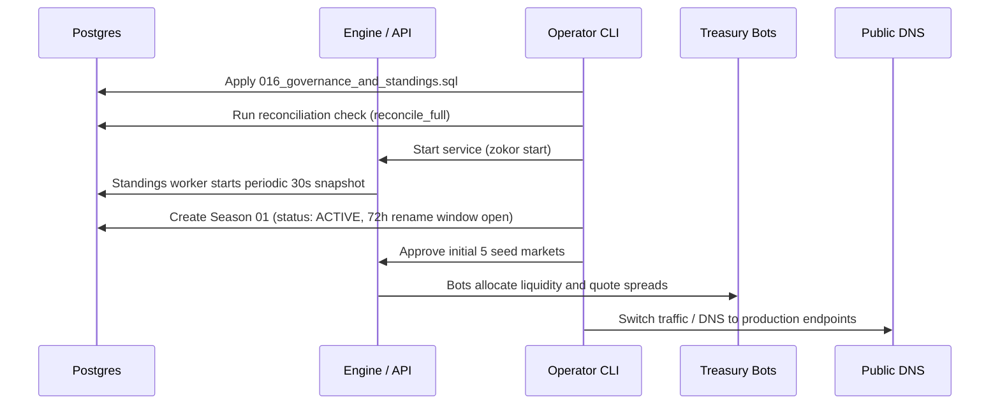

# say — Production Launch Guide

This guide establishes the strict pre-flight procedures, cutover sequencing, Day-1 monitoring, and abort/rollback criteria for launching **say** into production.

---

## 1. Pre-Flight Checklist

Before initiating cutover, ensure every item below has been verified:

- [ ] **Database Migrations Applied**:
  - Run `zokor migrate` and confirm all migrations up to `016_governance_and_standings.sql` are applied cleanly.
  - Verify indexes on `audit_events(created_at DESC, id DESC)`, `season_standings(season_id, profit DESC)`, and `username_reservations(reserved_until)`.
- [ ] **System Wallets Initialised**:
  - Verify `system:issuance` and `system:treasury` wallets are present and reconciliation reports zero imbalance.
- [ ] **Initial Issuance Policy Approved**:
  - Propose and approve P-1 issuance policy via dual operators:
    ```bash
    say admin issuance-policy propose --amount 1000 --cap 10000000 --operator <uuid_1>
    say admin issuance-policy approve --policy <policy_id> --operator <uuid_2>
    ```
- [ ] **Staff 2FA Enrolled**:
  - All staff accounts have enrolled and verified TOTP 2FA.
  - Staff roles (`curator`, `analyst`, `admin`, `super_admin`) assigned.
- [ ] **House Bots Quotas & Kill-Switches**:
  - Initial bot budget caps configured in `treasury_config`.
  - Global pause switch verified responsive (< 2s latency).
- [ ] **External Services Health**:
  - Email SMTP / Postmark configured and deliverability tested.
  - Postgres connection pool tuned (`max_conns = 100`, `timeout_ns = 2_000_000_000`).
  - Redis connection pool tested.

---

## 2. Cutover Sequencing

Execute the deployment sequence in this exact order:



1. **Database Migration**:
   ```bash
   DATABASE_URL="postgres://..." zokor migrate
   ```
2. **Reconciliation Dry-Run**:
   Run full ledger reconciliation. Confirm `imbalance_sedis == 0`.
3. **Start Core Services**:
   ```bash
   zokor start
   ```
4. **Create Season 01**:
   Insert Season 01 record with `status = 'ACTIVE'`, `starts_at = now()`, `ends_at = now() + interval '30 days'`.
5. **Seed Markets & Funding**:
   Curators create and approve opening for the 5 initial liquid markets.
6. **Activate House Bots**:
   Ensure `global_pause = false`. Bots will quote bid/ask within approved budget caps.
7. **Traffic Cutover**:
   Route ingress traffic through Cloudflare / load balancer to `say` API servers.

---

## 3. Day-1 Monitoring & Observability

During the first 24 hours of live trading, monitor the following metrics dashboard continuously:

| Component | Metric | Normal Range | Alert Threshold |
|---|---|---|---|
| **Ledger** | `ledger.reconciliation.imbalance` | `0` Sedis | `> 0` Sedis (SEV-1) |
| **Matching Engine** | `exchange.order.latency_p99` | `< 15ms` | `> 50ms` |
| **Matching Engine** | `exchange.command_queue.depth` | `< 50` | `> 500` |
| **Treasury Bots** | `treasury.bot.drawdown_pct` | `< 10%` | `> 25%` (Auto-halt) |
| **Leaderboard** | `standings.snapshot.duration_ms` | `< 250ms` | `> 1000ms` |
| **Auth & Security** | `auth.failed_logins_per_min` | `< 5` | `> 50` |
| **Approvals** | `approvals.pending_count` | `< 10` | `> 25` |

---

## 4. Rollback & Abort Criteria

Trigger an immediate operational halt if any of the following conditions occur:

1. **Ledger Discrepancy (SEV-1)**:
   - Any non-zero imbalance between system issuance and player balances.
   - **Action**: Run `say admin emergency pause`, halt ingress, freeze matching.
2. **Matching Engine Desync (SEV-1)**:
   - Order admission or hold reconciliation failure.
   - **Action**: Drain command queue, recover engine state from snapshot + WAL.
3. **Runaway Bot Drawdown (SEV-2)**:
   - Combined bot loss exceeds season loss limit (default: 50,000 Sedis).
   - **Action**: Trigger `POST /v1/admin/treasury/pause`, cancel all bot orders.
4. **Security Vulnerability / PII Leak (SEV-1)**:
   - Public profile endpoint or live feed leaking email, balances, or private quantities.
   - **Action**: Revert DNS to maintenance page, patch immediately.
