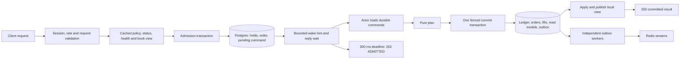
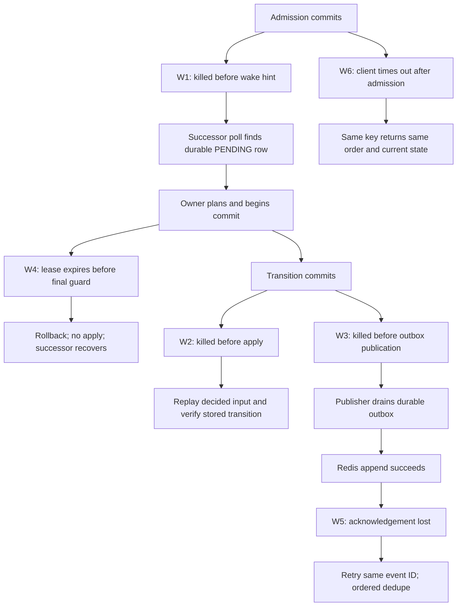

# Exchange runtime: admission, actors and durable execution

Status: **completed**. Runtime design approved 2026-10-27. Implementation completed 2026-10-28.
Design date: 2026-10-26.

The user authorized prompts 03–10 on 2026-10-27. This remains prompt 05's
PRD and technical contract. Registry APIs, core planning/apply/replay and measured core validation now
exist. Runtime migrations, ownership, node-heartbeat primitives, a committed
command-frontier reader, a commit-gated single-transition actor service
primitive, and a fenced transaction adapter are implemented. The adapter
commits journal postings, order/fill/position projections, market statistics,
and ordered audience-scoped outbox events with the command transition.
Durable Place admission and Cancel enqueue transactions are implemented, as
are service-side normalization and server-owned hold construction. The app
has a market supervisor, authenticated Place/Cancel routes, a public book
route, and process-local immutable book-view publication. Non-owner nodes
hydrate persisted views only while the matching owner epoch and node lease
are live; reads reject non-READY and expired views. Snapshot capture uses a
bounded writer queue; recovery tries up to 16 newest persisted snapshots,
verifies payload/full hashes and the covered journal hash, then replays the
decided suffix, falling back to an older snapshot or genesis when available.
Before an actor becomes usable, recovery compares the restored book to live
order rows, hold ownership/amounts, positions against share-wallet balances,
and market supply/collateral/hash projections. Private order reads and public
trades/history are implemented. All eight runtime acceptance suites, six process-kill
crash windows (W1–W6), and all five target load profiles have been verified
against isolated PostgreSQL and Redis containers, with full post-run ledger
reconciliation.

## 0. PRD, current project and boundaries

The runtime turns a validated order into a durable command, lets one owner
plan it, and makes its economic result visible only after PostgreSQL commit.
Users can buy, sell, cancel and query orders; market-data readers see
committed books/trades/history. PostgreSQL owns money, commands, ownership,
orders and recovery. Redis delivery can fail without losing confirmed trades.

| Consumer | Required behavior |
|---|---|
| Trader | Retry safely, never overspend across markets, receive a final committed result within the reply window or an explicit ADMITTED acknowledgement |
| Market actor | Own one book, process a gap-free sequence, await bounded Postgres operations and never wait for downstream delivery |
| Operator | Fence stale owners, recover from process death, quarantine mismatches and bound overload instead of accumulating memory |
| Frontend / prompts 06–07 | Read immutable book views and private order/position changes with event identity and sequence domains |
| Ledger / prompt 08 | Reconcile actual inventory/collateral and consume positions without a second money-moving path |

Current repository facts:

- Auth, ledger, registry APIs and the pure matching core are implemented.
  Registry seed/shared-approval integration continues with later modules.
  `CORE.md` documents actual Book/Workspace ownership, service Record DTOs,
  snapshot/restore and the internal authoritative RejectPlace command.
  Historical dependency/review language below records design-time questions;
  this current status and CORE.md take precedence.
- Migration 001 already creates markets, orders, UUID-keyed market_commands,
  fills, idempotency_records, outbox_events and market_snapshots. Runtime
  schema extends these; it does not create unrelated replacement tables.
- `src/ledger/store/posting.sl` already implements `post_many`, locking all
  touched user/bot wallets once in global `(season, owner, asset)` order.
  A second `post`/`post_many` call in one transaction is explicitly refused.
- Active postings take a season share lock. The proposed registry close
  path locks season before market. Runtime lock order must agree.
- `src/ledger/store/recon.sl` checks issued-pair totals against both outcome
  positions, collateral custody against issued-pair value, and order fee flags
  against FEE journals and position fee totals. Recovery additionally checks
  live order rows, order holds, account share-wallet balances and market
  sequence/hash/supply/collateral projections before READY.
- `src/ledger/store/seasons.sl` has `open_market_wallets`; season CLOSING
  becomes CLOSED only after no hold remains open.
- `src/platform/db/outbox.sl` separates legacy and runtime audiences. Both
  paths claim rows in short PostgreSQL transactions, publish to Redis outside
  those transactions, and acknowledge or schedule retries under the claim
  token. Runtime claims only each market/account source's ordered head and
  uses a Redis-side sequence cursor. Shard leadership and live
  PostgreSQL/Redis delivery validation remain outstanding.
- Existing session authentication can fall back from Redis to PostgreSQL.
  "Cheap checks first" therefore cannot mean an unconditional zero-I/O
  promise for authentication, halt misses or policy/state misses.

Keep `src/exchange/{domain,service,store,server}`. Domain stays the pure
matching core; service owns orchestration, actor state and ports; store
implements Postgres/Redis adapters; server owns DTOs/auth/error codes.
`platform/app` wires feature services/stores, immutable configuration,
clocks, node identity, metrics and workers. Only stores/platform/db import
pg; no tenant parameters are introduced. Use zokor scaffolding after review.

Acceptance requires the six crash windows, the cross-market S 427 spend
test, two-owner fencing, complete season-close cleanup, HTTP golden A–J,
100k runtime differential commands and a full reconciliation. Publish
measured latency/throughput/lag/RSS/recovery results for all requested load
profiles. No acceptance or performance result is established by this design.

## 1. Request path and durable admission

### 1.1 Request-path diagram and endpoints

The arrows into a success response require confirmed commit. A wake hint,
plan, Redis message or expired HTTP wait is never evidence of a fill.

| Route | Contract |
|---|---|
| POST /v1/markets/{id}/orders | Required UUID Idempotency-Key; limit `{outcome,side,price,qty,tif}`; market BUY `{outcome,side:BUY,type:market,spend}`; market SELL `{outcome,side:SELL,type:market,qty}` |
| DELETE /v1/orders/{id} | Authenticated owner cancellation, durable and idempotent |
| GET /v1/orders/{id} | Current committed order state, owner only |
| GET /v1/me/orders | market/status=open or all/cursor; authenticated author scope, bounded keyset page |
| GET /v1/markets/{id}/book | Public immutable view, no request-time DB query or actor message |
| GET /v1/markets/{id}/trades | Public committed fills, default/max bounded around requested limit=50 |
| GET /v1/markets/{id}/history | Public minute bars downsampled to about 120 points for 1H/6H/1D/1W/ALL |

Protected routes explicitly use auth.require_session. Public read intent
uses the project's zokor:public convention. Private lookups scope by
authenticated account ID in SQL; an unknown or another person's order
returns ORDER_NOT_FOUND. Private responses are no-store. No DTO can set
account, owner kind/group, hold IDs, sequence or epoch.

### 1.2 Cheap checks, retries and canonical intent

Validate session, rate, shape, positive bounded integers and checked
arithmetic before locks. Check cached halt, registry state, season, policy
band/tick/notional/quantity, runtime health and pending count. A stale or
absent authoritative cache fact invokes a bounded port fallback, never an
assumed OPEN/healthy state. Trading halt must be checked in PostgreSQL in
admission and fill commit even when its Redis mirror says false.

Idempotency hashes canonical **original client intent**: account, market,
request type, outcome, side and limit/qty/TIF or market spend/qty. Do not
include a derived market-order cap, changing book sequence, timestamp or
generated UUID; a retry after the book moves must still find the original
order. Persist original intent and normalized limit command separately.

After auth/rate/shape checks, look up an existing idempotency key before
current tradability/backpressure/quote rejection. Same intent returns the
existing order even if the market has since closed; a different intent is
IDEMPOTENCY_CONFLICT. For a new key perform all cheap checks, then repeat
the lookup under the admission transaction's per-key exclusion. Insert or
claim the unique `(account_id, scope='order', idem_key)` before any hold.
Concurrent identical requests must never reserve twice. Failed admission
rolls back the claim and all holds.

### 1.3 Market orders and budget protection

Operate in the order's own outcome prices. NO depth is the mirrored Yes
view: NO asks derive from Yes bids and NO bids from Yes asks. Never price
a No buy from the Yes ask. Require a usable versioned view; missing/stale
depth is not an invented quote.

For a BUY with spend S and F=1:

1. Require S>F. Let best be the lowest own-outcome ask. Compute
   `cap=min(max_price, best + market_slippage_ticks*tick)` with checked
   arithmetic; slippage ticks default 3, a nonnegative bounded per-market
   admission setting. Band/tick alignment remains valid.
2. Walk visible opposite levels through cap to obtain executable quantity
   and weighted cost under S−F. Separately compute worst-case hold quantity
   `q_hold=floor((S−F)/cap)`.
3. Use `qty=min(q_depth, q_hold, max_order_qty)`. Require positive qty and
   minimum original notional; reserve `qty*cap+F <= S`, submit IOC BUY.
   Return actual qty, cap and estimate/view sequence, never a fill promise.
4. A moved book can reduce execution; IOC releases the rest and improvement.
   No available protected quantity is NO_LIQUIDITY_IN_RANGE.

**Prompt arithmetic conflict:** weighted-depth affordability alone does not
prove the cap-priced hold fits. With S=101, F=1, ask=10 and cap=13, ten
shares cost 100 at the current ask but require a 131 hold. The additional
q_hold bound is necessary. Spend is a maximum, not a promise to spend it
all; top-50 visibility can under-estimate deeper liquidity safely.

For a market SELL, require visible own-outcome best bid and set
`limit=max(min_price, best_bid-slippage_ticks*tick)`, then IOC SELL requested
qty. Reserve shares plus a separate S 1 cash fee, even when sale proceeds
would be sufficient later. Empty bid is NO_LIQUIDITY_IN_RANGE. The response
returns the lower protection limit rather than misleading "up to" copy.

This prompt's three-tick rule supersedes MATCHING.md's earlier configurable
protection proposal. Changes to admission slippage settings are versioned
and audited; they are not a change to the core's immutable economics.

### 1.4 One admission transaction, no market-row lock

For a new key, in one short transaction:

1. Claim idempotency; enter the shared enqueue gate in §1.5.
2. Take needed season/halt share locks, recheck account eligibility,
   registry status/deadlines and runtime health through authoritative reads.
   No explicit market serialization lock is taken by admission; ordinary
   foreign-key key-share enforcement still applies.
3. Reserve a durable queue permit (§1.6), then call ledger post_many once
   with the new hold descriptions. BUY opens one sedi hold of qty*limit+1;
   SELL opens two holds, outcome shares qty and sedi 1. Stable keys include
   the preselected order UUID and asset purpose; reuse IDs across retries.
4. Insert order ADMITTED with original/normalized intent and returned hold
   IDs; accepted_seq stays NULL until the actor assigns its command seq.
   Insert market_commands with identity bigint ID, kind Place,
   immutable payload, state PENDING, seq NULL and its queue-permit reference.
5. Link the idempotency row to the order and commit. Any failure rolls back
   permits, order, command, idempotency claim and all holds.

Wallet locks from ledger, shared across markets, are the overspend defense.
Do not do a separate free-balance read and then write a hold unconditionally.
Sell two-hold admission cannot call hold twice: each existing hold wrapper
calls post, so use one post_many for both. Classify an insufficient SEDI
wallet as INSUFFICIENT_FUNDS and the outcome wallet as INSUFFICIENT_SHARES.

### 1.5 Command ID ordering needs a commit frontier

Bigserial allocation is not commit order. Admission A can allocate ID 10,
remain uncommitted, while B commits ID 11; an ordinary pending query sees
11 first. Assigning seq to 11 then later 10 violates the prompt's ID order.

Proposed solution: every command writer, including control subscribers,
holds a per-market **shared transaction advisory enqueue lock before
allocating its command ID**, through commit/rollback. Admissions remain
concurrent and never lock the market row. Before loading a batch the actor
briefly acquires the corresponding exclusive advisory lock in a separate,
bounded transaction, records a committed ID frontier, then releases it.
No earlier command ID can still be in flight under that frontier. It loads
up to 64 PENDING rows in ID order at/below that frontier, without SKIP LOCKED.
Rollback sequence gaps are harmless; uncommitted lower IDs are not skipped.

The frontier transaction performs no wallet/market-row locking. Never hold
this exclusive gate across matching or 64 economic commits. All writers
must participate; direct runtime inserts bypassing the gate are denied or
constrained. Advisory-key collisions may add contention, never corrupt
ordering; reserve the namespace and measure hot-market gate waits. This
is an explicit additional mechanism for review, not an assumption about
Postgres sequence behavior.

The store now exposes a transactional control-command enqueue and bounded
pending-command batch read. Control enqueue reserves a queue permit and
creates the pending command in one transaction, using the existing shared
advisory gate. Place admission must later insert the order, holds and command
in one larger transaction; it cannot use this control-only entry point.
The reader takes the exclusive per-market gate, captures the committed
command-ID frontier, and loads only pending commands at or below that
frontier before releasing the gate. A later actor can advance its cursor by
returned `command_id`; when the batch is empty it can advance to `frontier`.
The service can plan one decoded command, ask an `ActorWriter` to commit its
record with the current node and epoch, and apply it only after confirmed
commit. The Postgres writer shares a transaction with the ledger store,
fences owner/sequence state, and commits projections and ordered outbox rows.
This is a transition primitive, not a running actor: it does not yet assign
ownership, poll the queue, recover state, or publish an immutable BookView.
Durable order admission remains pending.

### 1.6 Backpressure and cancellation

Published pending_count rejects obviously full markets before starting the
transaction, with QUEUE_FULL/503 and Retry-After. That count alone is a soft
gate: concurrent requests and other nodes can all see space at once.

For a hard bound, propose a fixed number of sharded queue-budget rows per
market, with capacities summing to max_pending=5,000. Admission claims one
slot using conditional decrement on one shard; the actor returns that
permit exactly once with the command result. Hash keys spread requests;
bounded probing of other shards avoids one hot counter. No common market
row is locked. Exhausted/probe-limited capacity yields QUEUE_FULL, possibly
conservatively before every shard is exhausted. Queue rows are metadata,
not money or a second ledger.

Take the relevant queue-budget lock before ledger wallet locks in both
admission and commit. Otherwise admission budget→wallet and actor
wallet→budget would deadlock. A failed commit leaves the permit occupied
because its command is still pending; retries cannot leak or double-return
it. Reconcile permit usage against PENDING commands. Cancel/control work
has a separate bounded reserve so full Place capacity cannot prevent close
or release; lifecycle cleanup keeps a dedicated permit that cancels cannot
exhaust. Deduplicate a pending cancel per order and controls by source
event/version; never enqueue unlimited duplicates.

DELETE looks up the owned order. Finished orders return final state with
registered ORDER_NOT_CANCELLABLE; an already queued cancel returns its
existing result/acknowledgement. Otherwise insert Cancel durably, with a
unique cancellation identity and fresh command ID, hint and wait. It works
while suspended or globally halted because releasing holds must remain
possible. A Place/Cancel race is decided by the command order, not the
HTTP response order.

### 1.7 Bounded hints and the 300 ms reply

Use `select { send ...; default ... }` as the verified nonblocking-send
pattern; slang has no try_send function. Register a capacity-one reply
channel under order/command identity before sending the post-commit hint,
then check durable current status once to cover completion-before-register.
An actor never waits on a reply send: select/default drops a redundant
completion if the HTTP request has already left. Repeated HTTP requests
need a bounded waiter list, not an overwriting single order→channel entry.

No native receive timeout exists. A top-level timer task sends into a
capacity-one timer channel after the remaining reply deadline, or a shared
bounded timer service does so. Select reply versus timer, then unregister
on success, timeout or an observable disconnect. No unverified request
cancellation API is assumed; the deadline still bounds cleanup if transport
disconnect notification is unavailable. Do not close a channel that a timer or
actor may still send to. A timer whose reply loses the race can finish into
its one buffered slot and be collected; it cannot stay blocked forever.
Cap total request waiters/timers independently of durable queue size.

The 300 ms budget starts after confirmed admission commit; bound the
admission transaction separately. On final committed completion return 200
with order, filled_qty, avg_price, fee_charged, status and optional cap.
Otherwise return 202 `{order_id,status:ADMITTED}`; current state may already
have advanced, so the client follows GET/private stream. Preserve exact
integer principal and quantity; avg_price is a display ratio, not stored
fractional money.

A channel cannot cross nodes. Local actors signal local waiters. For
admission handled away from the owner, a bounded node-level completion
watcher polls the committed result through a PG port within the same wait
budget; no actor RPC or Redis wait is introduced. Its timeout returns 202.
Routing directly to owners can improve the hit rate but is not a hidden
correctness dependency.

## 2. Actor loop, lifecycle and controls

### 2.1 One book owner task

Actor state contains the pure core state/workspace, epoch and node
incarnation, committed_seq/book_seq, bounded mailbox, current unpublished
read view and at most one candidate awaiting commit. Waiter registries are
bounded shared runtime state, never inserted into the pure core. Each actor
holds no dedicated idle Postgres connection; pooled I/O parks its task.

The loop loads immediately on startup, then waits for mailbox or a 250 ms
safety tick; the timer is a verified timer-channel pattern. Process up to
64 ordered committed-frontier rows, one command per transaction:

1. Load durable command and captured policy/identity/hold facts.
2. Give it next seq=committed_seq+1, plan without mutating state.
3. Commit the full transition with owner/market/time/halt guards.
4. Only after confirmed success, apply the exact candidate and advance the
   local sequence; complete waiters nonblockingly.
5. Build an immutable view and attempt publication; kick outbox/metrics
   nonblockingly. Continue immediately while pending work remains.

The actor awaits Postgres loads/commit/recovery only. It does not await
Redis, HTTP, WebSocket, email, snapshot disk writes, full metric queues or
contended view publication. Domain remains free of all those operations.
Statement, lock and pool-acquisition deadlines bound PG waits. Measure
pool contention; reserve separate pool capacity for heartbeat and ordinary
HTTP so slow trading cannot consume every connection.

No batching initially. One transition per commit makes failure and replay
unambiguous; later stacking requires an explicit scratch-state protocol.

### 2.2 Authoritative rejection is a core-interface prerequisite

A candidate may plan fills from an OPEN core, then fail the commit's
authoritative check because the market suspended/closed, season ended or
global halt engaged. Do not commit its fills; do not apply it. Roll back,
then create a deterministic rejected-command transition that releases
verified admission holds, records REJECTED, advances seq and hashes, and
leaves the resting book consistent.

The implemented core provides internal RejectPlace with original verified
order facts and a bounded authoritative rejection reason. It releases holds,
advances sequence/hash and preserves makers/mode; exact oracle and decided
replay tests cover it. Persist this resolved input for recovery. Runtime
must not hand-edit hashes, forge transitions, temporarily mutate mode or add
I/O to the core. RejectPlace is not an HTTP caller-selected order type.

Gate failures are not retried as accepted fills. The rejected cleanup also
uses the full fenced commit path. Cancels, Close and rejection releases
must remain allowed when trading_halted or season CLOSING; the current
ledger allows ORDER_RELEASE in ACTIVE/CLOSING. If a release encounters a
season already CLOSED with open holds, quarantine and reconcile rather than
bypassing the ledger's season policy.

### 2.3 Durable control events and close draining

Subscriber ports translate market.suspended, market.opened/market.resumed,
market.closed and season.closing into durable Suspend/Resume/Close commands.
Use a unique source event/version key; retries cannot create duplicate
controls. For out-of-order events, reconcile current registry version and
desired state, preserving a durable consumer checkpoint. The current
proposed registry emits market.resumed; subscribing only to market.opened
would miss resumption. Poll PostgreSQL lifecycle/season facts as recovery
for a lost ephemeral stream; no Redis-only event cursor is authoritative.

Registry status can stop fills before its control reaches the queue. The
commit guard enforces that immediately; controls make book state and
recovery history catch up. Do not prioritize a later control ahead of an
earlier ID silently. Commands before it may be recorded rejected because
authoritative eligibility already ended.

Spawn for an owned OPEN market and also for SUSPENDED markets or closed
markets with resting orders/PENDING commands requiring recovery or release.
Close cancels the resting book, but ADMITTED orders not yet in the book can
still own holds. Drain/reject those pending placements and complete pending
cancels before stopping. A supervisor scans pending work in non-OPEN markets
so a late admission commit cannot orphan a hold after the actor exits.
Stopping at the first Close without this cleanup would strand season funds.

After ownership loss, stop new local planning immediately; never clean up
money under the lost epoch. The next owner recovers. Hibernation stays off
until actual actor-state measurements justify it; the bare task probe is
not a reason to add it. If later needed, snapshot/drain under fencing and
retain a bounded supervisor wake path, not a hidden second book owner.

## 3. Fenced commit, positions and retry decisions

### 3.1 Lock order and transaction steps

One PG transaction commits one resolved command/transition. The proposed
global order is season share lock, halt share lock when needed, market row,
command row, queue-budget shard, ledger wallet set, then position/read-model
rows. Multiple IDs within a class use stable canonical ordering. The enqueue
frontier transaction is separate and never takes these economic locks.
Ownership acquisition uses market then owner row; heartbeat only touches
node/owner rows and does not then acquire market/wallet locks.

**Difference from the prompt's first-lock wording:** taking market first
and letting ledger later take the season lock can deadlock against the
registry's season→market close path. Preserve its market-row fencing step,
but take the common season lock first. This needs integration tests with
the actual reviewed registry implementation.

1. On the locked market, verify node/epoch, committed_seq=next−1, policy
   economics and command still PENDING. Place/fill needs OPEN, unexpired
   close_at, ACTIVE unexpired season, a recovery-verified healthy owner and
   halt=false. New admission requires READY; an owner still RECOVERING may
   commit its startup frontier only after the persisted epoch-scoped
   recovery verification checkpoint succeeds.
   Cancel/Close/rejection releases do not require tradability.
2. Validate matching owner lease and expected command identity. Obtain the
   queue-budget lock needed to return this command's permit; it precedes
   all wallet locks. Never return a permit before command completion commits.
3. Materialize decided ledger descriptions and call existing post_many
   once. It creates/locks the union of wallets and posts all principal,
   share, fee and release transactions in order. Empty economic commands
   skip postings. There is no need for a second lock_wallets API or a loop
   of consume/release wrappers that each try to post independently.
4. Update every affected order: remaining/filled/cancelled quantities,
   status and fee_paid; a new Place sets accepted_seq to the actor-assigned
   command seq. Incoming rejection persists REJECTED even if the
   core's terminal cleanup record uses CANCELLED internally.
5. Insert immutable fills with unique (market_id, execution_seq, fill_index)
   and their actual principal journal ID. Preserve each fill's exact four-mode
   identity and both parties' own prices/outcomes.
6. Update position projections with the deterministic average-cost rule
   in §3.2, including fees separately. No wallet changes occur in this step.
7. Mark command DONE/REJECTED with assigned seq, canonical resolved input,
   canonical transition/hash, result and owner epoch; return its permit.
8. Update markets committed_seq, rolling_hash and book_seq only when
   aggregate book deltas changed. Registry version remains a separate domain.
9. Write stats, participants, minute bars, projected durable BookView and
   outbox rows (§4), all from the same decided effects. No external I/O.
10. A deferred transaction guard revalidates epoch and database-time lease
    at the final guard (§5.2); accepted fills also recheck deadline eligibility.
    Commit, then and only then apply/publish/reply.

All values remain bound SQL parameters. Journal restrictions stay intact.
Use statement/lock timeouts and the existing transaction wrapper, with
rollback on any failure. Checking a business key alone does not make
positions, stats, participants, outbox and command advancement idempotent;
the command PENDING→final CAS/unique seq fences the entire unit.

### 3.2 Integer average cost and market statistics

Position PK is `(account_id,market_id,season_id,outcome)`; qty, cost_basis,
realized_pnl and fees_paid are integer sedis/shares, with checked totals.
Let current quantity Q and remaining principal basis B. BUY k at own price
p adds k and p*k to Q/B. SELL k≤Q removes basis `floor(B*k/Q)` and realizes
`p*k-removed_basis`; a full sale removes all residual B. Compute the ratio
using checked wide arithmetic or exact PG numeric intermediates, returning
bounded bigint; never use floats or silently truncate overflowing B*k.
Keep rounding residue in the remaining position, so complete liquidation
leaves basis zero. Retain zero-qty rows for realized P/L and fee history.
Attribute each order's first-fill fee once to its outcome position.

The actor owns one market but the account's wallet can be touched by other
markets. post_many globally locks those shared wallets. This market's
position rows are still locked/upserted in stable account/outcome order;
new ownership must pass market fencing first.

Stats use actual committed fills; absent values remain null until known.
Yes bid/ask are best normalized bid/ask; No bid=V−Yes ask and No ask=V−Yes
bid, independently null when their source side is empty. Every book-changing
command refreshes quotes, even if it made no trade. last_price updates only
on fills. Participants are distinct maker/taker accounts with a unique
market/account row, counted only on first participation.

Proposed volume convention is canonical Yes notional `sum(x*qty)` once per
fill in all modes; do not double-count both counterparties or two newly
minted shares. Document this definition in API.md for UI approval. Persist
enough fill data to recompute it and 24h volume. Prompt 03's trending rank
remains 24h volume, then players, then newest; change_24h is its display
stat rather than an unannounced replacement ranking.

Minute bars use UTC minute buckets and persisted execution timestamps,
with open/close ordered by (seq,fill_index), high/low extrema and the same
volume definition. Define execution time from the successful DB attempt,
not a client clock. Recovery reuses stored timestamps and does not create
new bars. Bars are projections, not the source of fill or ledger truth.

### 3.3 Retries and uncertain COMMIT

Retry the identical candidate on serialization/deadlock/known rolled-back
statement timeout, up to three retries with bounded jittered backoff in the
runtime. Core receives no randomness/time and remains untouched. Re-run all
fences each time. An eligibility failure switches to rejected cleanup;
an epoch/lease loss stops the actor. A changed expected sequence requires
recovery, never blind advancement of local seq.

Connection loss or timeout while COMMIT is in flight has an **unknown**
outcome. Do not assume rollback, re-plan, return a definitive failed trade
or add another fee. Query the durable command/seq/hash on a fresh connection:

- Final with matching transition hash: commit succeeded; apply once or
  recover if local continuity is uncertain, and return the recorded result.
- Still PENDING after the original backend is known finished/rolled back:
  retry the same candidate under its fences.
- Backend unresolved, DB unavailable, mismatched hash or advanced state:
  mark locally degraded and recover/resolve before processing another command.

At retry exhaustion or unexpected failure, set separate runtime health
DEGRADED with an epoch-scoped update, alert through bounded signals and
retry/recover every five seconds while ownership remains valid. DEGRADED
is not a new registry lifecycle status. If PG is down and health cannot be
persisted, mark local views unavailable immediately; new admission still
cannot succeed without a valid PG transaction. Lease loss always wins over
the degraded retry loop. Never apply an unconfirmed transition.

## 4. Data leaving the actor

### 4.1 Ordered outbox and audience routing

Reuse outbox_events, its UUID id as event_id, and add explicit route/audience,
command/event ordinal and publisher-claim metadata. Public market rows route
only to stream:market:{market}; private rows only to stream:account:{account}.
Never broadcast order, balance or position payloads to the public market
stream. Legacy season/registry events retain their say:events route. Update
the existing publisher's predicate so it cannot claim runtime events and
incorrectly mark them delivered to the old stream.

| Event | Minimum durable identity/data |
|---|---|
| book.delta | event_id, market, book_seq, owner_epoch, changed levels in Yes terms |
| trade | event_id, market, seq, fill_index, yes_price, qty, aggressor |
| order.updated | Private account, order ID, final command/result and order revision |
| balance.changed | Private account and authoritative refresh/revision reference |
| position.changed | Private account, market, outcome and revision |
| book.view (proposed) | Public immutable top-50 view for non-owner node caches |

Shard workers by market using stable hashing and one active PG advisory
leader per shard. Within a market, publish lowest undelivered
(command_seq,event_ordinal) first; never SKIP LOCKED past its head to send a
later event. Keep Redis send outside economic transactions and actor tasks.
One Redis failure leaves the row pending/backed off and must not block
another market in the shard indefinitely; schedule per-market heads fairly.

Claims, event IDs and acknowledgements make retry at least once, but alone
cannot prevent a delayed old publisher appending after a successor. Proposed
Redis-side atomic script compares the source market sequence/ordinal,
deduplicates already applied event identity and appends plus advances its
cursor together. A stale/repeated send becomes a no-op, not an old logical
event after a new one. Use existing Redis adapter command support; do not
assume a new slang API. Test lost publisher sessions and delayed sends.
Private account streams merge markets; guarantee each source market's order,
not a fictional total market-sequence order across unrelated markets.

Redis is ephemeral: cursor loss/stream trimming requires prompt 06 resync
from durable reads. Do not claim exactly-once end-user delivery. Backlog
retention/replay must keep enough durable rows for outages; no finite
in-memory queue holds the 60-second outage backlog. Queue pressure does
not cause the actor to await Redis.

### 4.2 Stats task and history reads

A long-lived task every 30 seconds refreshes change_24h and
volume_24h_units from committed bars/fills. Use the configured market V
when deriving percentage-point change; missing 24h reference price yields
null, not a made-up zero. Coordinate writes so the task updates only its
derived fields and cannot overwrite the actor's newer quotes/volume.
Use per-job leadership/sharding and bounded pages.

History endpoints select public-market committed bars, cap range/results
and deterministically bucket into about 120 points, preserving OHLC and
summing volume. Do not interpolate missing trades as real trades. Trade
reads order by execution_seq/fill_index descending with stable cursors;
source prices stay integer sedis. API.md will specify exact JSON shapes.

### 4.3 Asynchronous snapshots

Every 5,000 commands or 60 seconds of activity, capture a deep immutable
snapshot of applied state, covered seq, rolling hash and full checksum.
Do not pass the mutable book or reusable core scratch to the writer.
Submit to a bounded writer queue with coalescing/drop-on-full metrics.
Writer failure cannot roll back a trade or stall the actor. A later owner
may accept a delayed old-epoch snapshot only after verifying its covered
committed transition/hash; otherwise discard it.

Insert append-only snapshots uniquely by market/covered seq/schema version.
Full-hash verification precedes recovery. Keep older snapshots and decided
command history until retention establishes a verified recovery chain.
Snapshot serialization is CPU work measured separately; moving insertion
off-task does not make serialization cost vanish.

### 4.4 Immutable view publication and non-owner reads

BookView contains book_seq, committed_seq for freshness, owner_epoch,
top 50 aggregate bid/ask levels in Yes prices, last_price, pending_count
and as_of/health metadata. Lists/records are fully built before publication
and never mutated after it. Slang has no verified public atomic-reference
swap API; `gc struct` and assignment alone do not make cross-task access safe.

Use a per-market ViewCell protected by a short mutex. Readers lock, copy
the immutable reference, unlock, then serialize outside the lock. Actor
uses mutex_trylock: if contended, retain/coalesce its newest unpublished
view and retry on the next loop/tick, never park on a reader. Heartbeat or
view worker can invalidate cells independently on ownership/health changes.
Measure publication lag/contention; stale/unavailable views fail explicitly,
not by holding a lock across PG or response serialization.

Non-owner nodes cannot read an owner's local pointer. Proposed additional
market_book_views projection stores the committed projected top-50 view
in the same transaction, and a book.view outbox row replicates it into
each node's cache. A background PG hydration path repairs missed events;
the GET/estimate handler itself reads memory only. Project the post-transition
view from decided level deltas/read-only state, never mutate the live core
before commit. Owner publishes after apply; remote published versions are
backed by the already committed transition. Compare epoch plus sequence
to reject old-owner updates. A current BookView may use the same book_seq
when only pending_count/health changed; use committed_seq/as_of as needed.

Treat pending_count as an approximate early gate, repaired every poll;
durable queue permits are its hard safety counterpart. Staleness policy
(proposed one second for market-order estimates) is explicit. A stale quote
may reduce IOC execution, but cannot loosen cap/spend/hold constraints.
Prompt 03's public-card snapshot builder consumes committed stats, not
uncommitted actor data.

## 5. Ownership, fencing, recovery and crash windows

### 5.1 Ownership and assignment

Use a fresh node incarnation UUID on each process boot, registered in nodes
with heartbeat time and liveness deadline. Rendezvous hashing over a common
live-node snapshot proposes a preferred owner. That choice reduces work;
only database fencing grants authority.

Acquire in a transaction locking market then market_owners in that order.
Create a missing owner row safely; for expired/released ownership increment
epoch once, set node/lease_until=DB time+10s and copy epoch to markets.
Return the epoch only after commit. A local actor registry ensures one task
per (market,epoch). A same-node heartbeat renews rather than increments epoch;
the prompt's `node_id=me` acquisition condition must not be mistaken for
permission to spawn duplicate actors or bump the epoch every two seconds.

One heartbeat task per node updates node liveness and renews its expected
market/epoch pairs in one statement every two seconds. Conditional renewal
requires unexpired lease and matching incarnation/epoch; do not resurrect
an expired lease. Missing expected rows/deadlines invalidate the affected
actors/views and stop node trading if renewal state is uncertain. Limit
heartbeat pool/statement waits so 50 ms trading injection does not consume
its whole ten-second lease budget.

Planned handoff marks runtime DRAINING to reject new placements, drains
pending work under the old epoch, writes/acknowledges a snapshot, stops the
old actor, then releases. Snapshot failure can fall back to replay if the
handoff policy explicitly allows it; no dual writer is created. Suspended
and closed-with-work markets participate in assignment for cleanup.

### 5.2 What actually fences an expired lease

Epoch comparison only at transaction start is insufficient for the prompt's
expiry-mid-transaction test: expiry alone does not increment epoch, and a
takeover may be waiting on the old transaction's market lock.

Propose a deferred constraint trigger on completed command writes. At the
final guard it checks market/owner/node incarnation and expected epoch,
locks the matching owner fact consistently, and requires
`lease_until > clock_timestamp()`. Accepted fill commands also require an
unexpired close_at/season end. Use clock_timestamp, not the transaction-start
value of now, for these wall-time checks. Failure rolls back the whole
transition, including ledger entries, before apply.

Takeover and fill both serialize on the market row; no new owner can change
its epoch while the old commit holds that lock. Heartbeat never revives an
already expired lease. The precise guarantee is validity at the final guard
and serialized epoch ownership; no SQL time check can preempt an OS/DB pause
after that check or make a network acknowledgement arrive before lease end.
Fault tests pause before the guard, expire the lease, then verify rollback
and successful successor recovery. Record this timing boundary honestly.

### 5.3 Recovery

1. Acquire a new fenced epoch; set runtime RECOVERING and reject new
   placements while allowing safe existing-result reads.
2. Load newest supported snapshot, verify full checksum/schema/policy and
   covered committed hash. On a corrupt snapshot, try an older verified one
   while recording the corruption; absent valid snapshots, use genesis.
3. Read finalized command rows in contiguous seq order. This prompt asks
   plan/apply replay: run the pure planner with each **stored resolved input**,
   compare its canonical result to the stored decided transition/hash, then
   apply. Never re-evaluate current time/halt/status/quote or create new
   ledger postings/events during replay. A mismatch degrades the market.
4. Cross-check complete resting order identity/quantities/fees/holds against
   PostgreSQL, and backed supply/collateral against journal sums. Reconcile
   ADMITTED/PENDING work separately; it is not already on the resting book.
5. Open missing system market wallets through the existing ledger/store
   hook in the appropriate lifecycle transaction. Never seed balances by
   directly changing wallets. Publish no tradable view before checks pass.
6. Persist an epoch-scoped recovery-verified checkpoint, capture the startup
   command frontier, and process its PENDING work in ID order while new
   placements remain disabled. Enter READY and publish an immutable
   epoch-tagged view after that frontier drains; retain cleanup capability
   for SUSPENDED/CLOSED markets.

This reconciles prompt 05's command re-planning with prompt 04's decided
replay contract: recomputation verifies the durable decision rather than
choosing new trades. Persist enough immutable original and resolved facts
for that verification; the pure core API must support them. Recovery cannot
depend on a previously assigned process-local order slot.

### 5.4 Crash-window diagram and required outcomes

Every window needs a real-process kill/signal test with deterministic
barriers, not just mocked exceptions. Also kill during snapshot write,
heartbeat loss, permit return and command-frontier acquisition. Never
infer a rollback solely from the client receiving an error.

## 6. Reconciliation and season close

Extend the ledger's current reconciler without weakening its journal,
grant, wallet/hold or season-isolation checks. Use one consistent database
snapshot for dependent reads; separate READ COMMITTED queries can falsely
compare a new wallet balance to an older position. Incremental checks
identify touched markets/accounts, while full runs cover all live facts.

| Check | Authoritative comparison |
|---|---|
| Supply | Negative journal balances of system:shares:<market> for YES and NO equal nonnegative issued pairs and actual user/bot share supply |
| Collateral | Journal sum for system:collateral:<market> SEDI equals V*issued pairs; do not read zero-valued cached system wallet fields |
| Fee once | Unique fee:<order> posting of exactly F for every ever-filled order, no fee for never-filled orders; validate entries/hold consumption, not just row count |
| Holds/order liveness | Every open order hold belongs to ADMITTED/PENDING or OPEN/PARTIAL live work; ended orders have no open holds; active budgets match remaining and unpaid fee |
| Positions | Position qty equals matching share wallet free+held, per account/market/season/outcome; cost-basis/realized/fee totals recompute from fills/postings |
| Queue/sequence | Occupied permits equal pending command claims; finalized market seq is gap-free and agrees with stored transition chain |

Do not label an admitted-but-not-yet-resting order's valid hold an orphan.
If a non-order hold belongs to another authorized ledger use case, check
its declared reference type rather than incorrectly requiring every hold
in the whole service to name an exchange order.

A failure sets the existing trading_halt and emits the registered critical
signals/outbox path. Do not auto-repair financial projections or journal
entries silently. Cancels/close/releases remain possible under halt.

On season.closing, authoritative guards block new fills regardless of event
lag, durable Close drains resting orders, and pending placements are rejected
with full hold release. The season scheduler then observes no open holds
and reaches CLOSED. Positions/collateral persist in the old season for
prompt 08; closing trading is not settlement or a refund of filled positions.

Future settlement will retire supply/positions; reconciliation must become
phase-aware in prompt 08 rather than permanently demanding pre-settlement
inventory after authorized redemptions. No settlement logic is added here.

## 7. Proposed migration and contract inventory

Use forward-only migrations after the reviewed registry/core dependencies;
do not edit migrations 001–004 or assume every legacy row is empty. Preflight
existing commands/fills/snapshots and preserve UUID/public references.

| Object | Proposed change |
|---|---|
| orders | ADMITTED status; hold references, original/normalized intent, user/bot/group facts, fee_paid, filled/cancelled counters, revisions and committed result; author/status/time indexes |
| idempotency_records | Keep unique account/scope/key, canonical intent hash and linked order; use transaction-safe claim; do not expire before retry-retention contract |
| market_commands | Add bigint identity ordering ID while retaining legacy UUID as command/public reference; seq nullable for PENDING, kind/payload/resolved input, DONE/REJECTED result, canonical transition/hash, epoch, source dedupe, queue permit; unique nonnull market/seq and pending market/ID index |
| fills | Preserve UUID and journal links; extend mode CHECK to four precise core modes; unique market/execution_seq/fill_index; execution time, prices/party projections if needed |
| positions | Composite account/market/season/outcome key, qty/basis/realized_pnl/fees_paid; checked integers, account/season reads |
| market_participants | Unique market/account with first participation facts, count only successful new rows |
| market_price_points | Unique market/UTC-minute OHLC/volume plus first/last seq/fill index for deterministic updates |
| market_snapshots | Extend existing payload/hash/covered seq columns with supported binary format/version and rolling/full hash; immutable append-only recovery records |
| market_owners / nodes | Ownership epoch/lease and fresh node incarnation/liveness; uniqueness by market, expiry/node indexes |
| markets | Retain owner_epoch/committed_seq/book_seq; add rolling_hash and separate runtime_status/reason/epoch metadata; do not add DEGRADED to registry status enum |
| market_stats | Registry table extended for defined quote/volume/player/24h projections |
| market_queue_budgets | Fixed shard capacities and remaining permits; referenced command permit ownership, distinct bounded control reserve |
| market_book_views | Committed immutable view projection for background cross-node hydration |
| outbox_events | Existing event UUID, explicit audience/route, deterministic ordinal and claim/retry state; ordered per-market undelivered index |

Constraint/privilege work includes final commit fencing/deadline guard,
allowed command state/seq combinations, hold links, order counters, foreign
key indexes and append-only finalized command/fill/snapshot protection.
Override broad say_app default privileges on immutable data. Owner/schema
credentials migrate; runtime uses the restricted app role. No destructive
conversion or fictitious legacy transition/hash backfill is authorized.

All new settings are read once in platform/config: node/lease/heartbeat
durations, batch=64, poll=250ms, wait=300ms, queue/waiter/mailbox limits,
pool reservations, retry deadlines, snapshot thresholds, view freshness,
outbox shards/retention and slippage default. Per-market slippage overrides
are validated/audited facts, not arbitrary request inputs.

## 8. Errors and observability

Register every HTTP code in exchange/server/errors.sl, reusing common and
ledger codes where already registered. Stores log internal failures through
signals; raw SQL/network errors never appear in client messages.

| Code | HTTP / meaning |
|---|---|
| INSUFFICIENT_FUNDS | 409; actual available sedi budget cannot cover required hold |
| INSUFFICIENT_SHARES | 409; actual free outcome shares cannot cover sell |
| MARKET_NOT_OPEN / MARKET_SUSPENDED | 409; authoritative registry/core eligibility |
| TRADING_HALTED | 503; fills/admission paused, releases still supported |
| SEASON_NOT_ACTIVE | 409; wrong/ended season for trading |
| PRICE_OUT_OF_BAND / OFF_TICK | 422; price field |
| BELOW_MIN_NOTIONAL / QTY_TOO_LARGE | 422; qty/price field |
| NO_LIQUIDITY_IN_RANGE | 409; no usable protected executable size |
| IDEMPOTENCY_CONFLICT | 409; same key, different original intent |
| QUEUE_FULL | 503 plus Retry-After; bounded durable or request capacity exhausted |
| MARKET_DEGRADED | 503; recovering/degraded/unusable fresh view |
| RATE_LIMITED | 429; existing limit contract |
| ORDER_NOT_FOUND | 404; unknown/not owned |
| ORDER_NOT_CANCELLABLE | 409 plus current committed final order state |
| BAD_REQUEST / UNAUTHENTICATED / UNAVAILABLE | Existing 400/401/503 conventions |

Use actual locked balances to say "That's more than your S 427 balance."
and "You have 8 Yes shares free. The other 4 are in a sell order." Do not
claim a hold is specifically a sell order without a matching reference.
Provide field paths for price/qty/spend/outcome/TIF/key validation. Later
API.md defines exact result/error/private-event DTOs, preserving the shared
error envelope and avoiding double registration conflicts.

Measure admission transaction and total request separately from 300 ms
post-commit wait. Record order-to-fill admission/queue/plan/lock/commit
components, cancel latency, per-market commands/s, queued age/count,
mailbox drops/depth, permit usage, actor runnable/view lag, heartbeat margin,
retries/unknown commits/degraded markets, PG pool waits, outbox lag/backlog,
snapshot age/write drops, recovery duration, RSS/GC and invariant failures.
Bound labels/cardinality; metrics cannot block a commit.

## 9. Fault and load verification plan

Use isolated real PostgreSQL/Redis and child service processes. Harness
barriers are test-only and never ship; fakes remain *_test.sl. Tests include:

- All six crash windows in §5.4, including ambiguous COMMIT replies and
  Redis publish/ack duplication, not just process restart smoke tests.
- Reverse commit order of two admissions: lower command ID remains first;
  rollback-created ID gaps do not stall the frontier.
- Concurrent same-key orders after quote changes, closure and queue full:
  one order/hold set; changed payload conflicts; original cap remains.
- S 427, ten markets, 200 parallel buys: held never exceeds funds, no negative
  balance; repeat SELL cash/share two-hold failures and verify atomic rollback.
- Two nodes/duplicate actors, stale epoch, expired lease before final guard,
  failed heartbeat and delayed publisher sends; only valid owners commit.
- Market-buy weighted affordability counterexample, NO mirroring, empty
  depth, slippage/tick boundaries, stale views and max quantity/notional.
- Full queues still allow bounded cancels/close. Pending ADMITTED holds
  survive restart and all release on season close; no actor-exit orphan.
- Golden A–J through HTTP with actual ledger balances/fees/positions/stats,
  plus average-cost rounding, full liquidation and replay equality.
- 100k-command runtime differential run and complete reconciliation;
  inject corrupted snapshots, transition hash mismatch and projection drift.
- View contention/immutability, non-owner reads, late waiter registration,
  disconnect/timeouts and bounded queues; no leaked blocked timer senders.

Load profiles are one hot market taking 80% of 2,000 offered orders/s,
1,000 distributed markets, cancel storm, 50 ms injected PG latency and
60 seconds of Redis outage followed by drain. Report offered/admitted/
completed/rejected rates separately; one-command commits at 50 ms cannot
sustain hot-market 1,600 commands/s, so that profile verifies bounded queue
and isolation rather than pretending unchanged throughput. Publish
p50/p95/p99 and hardware/compiler/DB flags, dataset, duration, pool/worker
counts, peak RSS, unrelated-endpoint latency, reconciliation and recovery
results. The idle-task probe in slang-notes.md is not an actor load test.

Run changed-area tests and integration/fault suites after implementation,
then make check.

### 9.1 Acceptance and fault results

All 8 scenarios in `tools/runtime/acceptance.py` pass against isolated PostgreSQL
and Redis containers:

| Scenario | Duration | Operations | Verification |
|---|---|---|---|
| `financial_http` | 5.09s | 8 commands | All four modes (MINT, TRANSFER_YES, TRANSFER_NO, MERGE) executed; full reconciliation passed |
| `golden_http_A_J` | 21.06s | 48 commands | Golden cases A–J executed via HTTP; complete post-run ledger reconciliation passed |
| `cross_market_budget` | 4.44s | 200 requests | 200 parallel buys across 10 markets; S 410 held from S 427, S 17 free, zero negative balance; 10 admitted, 117 rejected (409), 73 rate limited (429) |
| `lifecycle_and_cross_node_views` | 3.53s | 6 commands | Cross-node genesis view hydration, suspend/resume/close lifecycle transitions verified |
| `admission_process_crashes` | 10.98s | 1 command | W1 (kill after admission before actor wake) and W6 (client timeout retry) verified |
| `commit_process_crash` | 10.60s | 1 command | W2 (kill after commit before apply) recovered via pure recomputation/apply replay |
| `two_owner_final_guard` | 12.45s | 1 command | W4 (lease expiration before final guard) aborted by PostgreSQL; successor node recovered and committed |
| `outbox_process_crashes` | 1.04s | 2 windows | W3 (kill before outbox publication) and W5 (Redis append ack loss) deduplicated without data loss |

### 9.2 Measured load profiles

All 5 load profiles were executed under 2,000 req/s offered rate with 64 workers,
256 client queue capacity, and 64 DB pool connections (`tools/runtime/load.py --profile all`
saved to `docs/exchange/runtime-load-results.json`):

| Profile | Markets | Admitted / Completed | HTTP p50 / p99 | Health p50 / p99 | Peak RSS | Drain | Outcome |
|---|---|---|---|---|---|---|---|
| `hot` | 10 | 192 / 192 | 84.7ms / 2676.9ms | 1.03ms / 5.93ms | 28.5 MB | 3.6s | 0 rejected, 0 pending, 0 degraded, recon passed |
| `distributed_1000` | 1,000 | 401 / 403 | 1999.7ms / 3226.7ms | 1.09ms / 42.74ms | 403.9 MB | 8.8s | 0 rejected, 0 pending, 0 degraded, recon passed |
| `cancel_storm` | 20 | 0 / 1,851 | 137.4ms / 798.2ms | 1.02ms / 4.61ms | 43.6 MB | 4.3s | 0 rejected, 0 pending, 0 degraded, recon passed |
| `postgres_50ms` | 10 | 104 / 104 | 99.4ms / 3533.9ms | 1.41ms / 7.40ms | 41.1 MB | 1.8s | 0 rejected, 0 pending, 0 degraded, recon passed |
| `redis_outage_60s` | 10 | 489 / 490 | 683.6ms / 2237.4ms | 1.05ms / 30.72ms | 27.4 MB | 0.0s | 60s outage, outbox drained in 36.2s, 0 pending, recon passed |

### 9.3 Differential verification

`tools/runtime/differential.py` verified 1,000 commands across 10 markets across
all four execution modes (240 MERGE, 90 TRANSFER_YES, 90 MINT, 80 TRANSFER_NO)
at 31.4 commands/s. All 10/10 recovered sequence hashes matched exactly, and post-run
ledger reconciliation passed with zero invariant errors.

## 10. Review decisions and later prompts

| Decision | Proposal / issue to review |
|---|---|
| R1: Dependencies | Registry and core remain proposed; finalize their interfaces before runtime code |
| R2: Command ordering | Shared enqueue gate plus exclusive committed frontier preserves bigint ID order without admission locking the market row |
| R3: Budget/overload | Cap-priced q_hold bound for market buys; durable sharded queue permits beyond the approximate published count |
| R4: Rejection/close | Resolve pure core rejection input; drain pending admitted holds after Close before final actor shutdown |
| R5: Locking | Season/halt before market and budget before wallets; one existing post_many call per transaction |
| R6: Fencing | Separate renewal from epoch acquisition; final DB-time lease/deadline guard; state its precise timing boundary |
| R7: Unknown outcome | Resolve uncertain COMMIT from durable command/hash before applying, retrying or processing another command |
| R8: Read views | Immutable ViewCell with actor trylock, bounded replication/background PG hydration for non-owner nodes |
| R9: Recovery | Re-plan stored resolved inputs, compare canonical decided transitions, then apply without any new financial writes |
| R10: Read models | Integer average cost with residue retained, explicit canonical-Yes-notional volume and versioned bars/stats |
| R11: Delivery | Explicit private/public routes and ordered shard heads with Redis-side stale/dedup guard; preserve legacy say:events lifecycle path |
| R12: Task cost | Bare 1,000/5,000-task probe supports starting with one actor per market; no hibernation until full actor measurements justify it |

After review, implement schema and dependency interfaces, admission/ledger
batching, ownership/fences and recovery, actors/read views, routing/publishers,
read models/reconciliation, then fault and load gates. Publish API.md and a
performance report with actual results and unresolved limits.

Later work: WebSocket fanout/gap recovery (06), portfolio and notification
reads (07), settlement from positions/collateral (08), and bot orders using
this exact admission/hold path (09). No direct bot matching or wallet writes,
no settlement and no notification-delivery claim is introduced here.

### Implementation validation

All runtime components are implemented and validated:
- Schema migrations 011 and 012 applied cleanly under owner and app roles.
- `make test-runtime` passed all 8 acceptance and fault scenarios.
- All 5 load profiles passed with bounded queue and zero reconciliation drift (`docs/exchange/runtime-load-results.json`).
- Differential execution passed 1,000 commands across 10 markets across all 4 modes (`docs/exchange/runtime-differential-results.json`).
- `bin/say` and `bin/runtime-fixture` built successfully with Slang 0.2.4.

