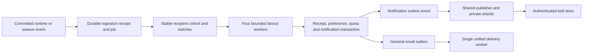

# Portfolio and notifications

Status: **proposed; awaiting review**. Date: 2026-10-26.

This is prompt 07's design deliverable, covering valuation, read models,
notifications and empty/edge states. Review precedes migrations, endpoints,
shared JSON vectors, client additions and tests. No portfolio, notification
delivery or prerequisite exchange implementation is claimed here.

## 0. PRD and existing project

### Product outcomes

| Surface | Required outcome |
|---|---|
| Season summary | Available cash, cash held, held shares, marked positions, total and change from the actual starting grant; rank only when available |
| Positions | Own-outcome shares/free/held, average cost, mark source, value and unrealised P/L; paused/unsettled states remain explicit |
| Open orders | Filled fraction, meaningful status, actual remaining cash/share holds and cancellation eligibility |
| Settled | Only committed settlement results; no proposed payout counted as money received |
| Activity | Existing ledger history with sufficient metadata to render each line without another request |
| Notification bell | Idempotent, coalesced personal updates, accurate unread state and bounded noise |
| Preferences/email | Independent in-app/email choices, weekly recap off by default, unsubscribe scoped to the intended email preference |

The supplied summary example is an acceptance fixture:
`427 available + 109 held + 978 position value = 1,514 total`, and
`1,514 − 1,000 grant = +514`. Held shares are already part of position
quantity and must not be added again. Rank #38 of 3,180 is illustrative;
rank is null until the standings provider exists.

This is backend/read-contract and client-helper work. There is no existing
frontend screen/package to restyle in this workspace. Preserve the supplied
tab labels and copy intent through API fields and later integration; do
not claim visual parity or a built Portfolio screen from this document.

### Inspected sources and dependencies

- Auth and ledger are implemented; prompts 03–06 remain proposed designs.
  There are no positions/market_stats tables, runtime events, live gateway
  or packages/say-stream implementation yet.
- `src/ledger/store/reads.sl` already reads available/held/starting_grant by
  season and builds ledger pages; server exposes /v1/me/balance, /ledger
  and a small /summary. That summary is not the proposed portfolio summary.
- `starting_grant` is nullable. Verification can succeed with no grant when
  issuance is unavailable/capped. Never manufacture an S 1,000 balance.
- Runtime design proposes average-cost positions, separate fees, integer
  ledger postings and reconciliation. These contracts need implementation
  before real portfolio values can be served.
- `src/ledger/store/grants.sl` emits **season.grants_done** for a rollover
  pass, without a per-grant event. Mid-season verification grants can
  occur after that event.
- Finalization is intentionally blocked until settlement arrives; there is
  no current season.finalized producer or standings table.
- `auth_outbox` is restricted to sealed otp_email payloads. The current
  auth drainer and immediate attempt share a leased claim path; the provider
  EmailMessage/send interface has no delivery-id/idempotency field.
- Journal rows are append-only for say_app, and ledger idempotency excludes
  display metadata. Enrich Activity without rewriting old journal entries.

Use `src/portfolio/{domain,service,store,server}` and
`src/notifications/{domain,service,store,server}`. Scaffold features/routes
with zokor after review. Domain/service do no direct I/O; store adapters
implement their ports; platform/app wires accounts/ledger/markets/exchange
contracts, pools, clocks, email and shared outbox delivery. Cross-feature
interaction uses service contracts, except stores sharing a transaction as
AGENTS.md explicitly permits. No tenant arguments or money-moving path is
introduced. Reuse docs/auth/slang-notes.md for spawn/join, bounded channels,
explicit mutex lifetime and held-connection advisory leases.

## 1. Valuation: one exact definition

### 1.1 Inputs, outcome prices and source precedence

Capture one immutable market-stats generation per request. For each
positive-quantity position, use its own outcome:

1. If an actual last trade is known, YES mark is last Yes price; NO mark
   is V−last Yes price. Source is `last_trade`.
2. Otherwise, if both own-outcome bid and ask exist, mark is
   `floor((own_bid+own_ask)/2)`. Source is `mid`.
3. Otherwise mark is exact remaining average principal cost
   `cost_basis/qty`. Source is `avg_cost`.

For NO, own bid=V−Yes ask and own ask=V−Yes bid. Convert **before** midpoint
rounding. With V=100, Yes 50/51 gives Yes midpoint 50 but No 49/50 gives
No midpoint 49. Complementing the rounded Yes midpoint would incorrectly
give 50. One-sided quotes do not form a midpoint. A stale/unavailable stats
generation is not evidence that a market never traded: distinguish cache
unavailability from a valid snapshot with null prices, and fail unavailable
or report explicitly stale valuation under the reviewed freshness policy.

Validate known prices against policy; do not clamp corrupt stats into a
plausible mark. A known position referencing absent market/policy data is
an inconsistency, not permission to make up V or a quote.

### 1.2 Exact cost fallback, value and P/L

Money, basis and quantity are checked integers. Average cost may be a
fraction even though every trade price was integral. Preserve it as a
rational numerator/denominator; only presentation rounds it. For an
avg_cost fallback, `qty * (cost_basis/qty) = cost_basis` exactly, so a market
with no price does not invent a loss due to prematurely rounded averages.
For example qty=3, basis=101 has value 101, not 99.

Proposed API representation: avg_price and mark are exact rational records
`{ numerator: "101", denominator: "3" }`, with denominator positive. Last
trade and rounded midpoint marks have denominator 1. This makes precision
explicit rather than returning an unstable mixture of integer/float/string.
It requires review because the prompt names these fields without fixing
their types. The client formats "avg → now" from ratios, never parses a
rounded display label back into value.

```text
value = qty * mark
unrealized_pnl = value - cost_basis
pnl_pct = trunc_toward_zero(100 * unrealized_pnl / cost_basis)
```

Value is an integer: last/mid mark is integral, and avg_cost cancels to
basis. Proposed pnl_pct is whole percentage points; -1/3 yields -33%, not
-34%. If basis=0, pnl_pct=null; if qty=0 exclude the row from open positions
and never divide by zero. Negative basis/quantity is invalid state.
Use checked products/sums or verified exact wider intermediates; JSON
money/quantity/ratio components use canonical decimal strings compatible
with the stream design's bigint client. No floating-point money arithmetic.

Fees are excluded from remaining principal basis and this defined
unrealised P/L. They have already reduced actual cash. Keep fees separately
for breakdown/results; do not subtract them again from season total.

### 1.3 Season total and authoritative holdings

```text
positions_value = sum(value of positive-qty unsettled positions)
total = available_SEDI + held_SEDI + positions_value
season_pnl = total - actual_starting_grant
```

Share wallets provide qty_free and qty_in_orders; their sum must equal the
position's total qty. Cash held includes purchase principal and unpaid
fees; a sell order's reserved shares are not SEDI. Held shares are reported
separately by market/outcome but included in positions_value exactly once.

**Realised P/L clarification:** after a sale its proceeds are already in
cash. Retain positions.realized_pnl for history/breakdown, including qty=0
rows, but never add it separately to the total formula. Doing so counts
the sale twice. A property test must exercise complete liquidation.

Read current cash from ledger-maintained wallets and validate position qty
against free+held share wallets. If a projection disagrees, the ledger wins
and reconciliation is flagged. Do not combine a ledger quantity with an
untrusted stale basis to fabricate a complete P/L; return an explicit
unavailable/inconsistent result until the projection can be trusted. This
module never fixes the discrepancy by changing a wallet or journal.

If the actual grant record is absent, preserve starting_grant=null and
propose season_pnl=null rather than guessing a S 1,000 baseline. Total and
available remain actual values. The UI needs a grant-pending state; this
is a review decision, not an assertion that every empty account is funded.

### 1.4 Unsettled and settled states

Suspended positions retain valuation but are not sellable. CLOSED,
RESOLUTION_PENDING, DISPUTED, RESOLVED and SETTLING positions with qty>0
remain marked exposure until their account settlement commits. Expose a
separate position_status=RESOLVING and optional public proposed_outcome;
do not overwrite the authoritative market.status enum or mark at V merely
because a proposal/approved result exists. No payout enters available/total
until it is actually posted.

position_results is written by prompt 08 in the same transaction as payout,
position/share retirement and final account result. Once it exists, use
that committed paid_out/pnl, not `expected_payout`. Results must declare
how previous sales and fees are allocated; proposed lifetime outcome P/L
is realised principal P/L + payout − remaining basis − allocated fees.
Prompt 08 must finalize that contract; this reader must not invent a
different settlement calculation or refund policy.

### 1.5 Shared valuation vectors planned after review

spec/valuation-vectors.json will be the single language-neutral fixture
corpus, run independently against slang and TypeScript implementations.
Do not create a second hand-maintained client truth table. Proposed cases:

| Case | Expected result |
|---|---|
| Supplied summary | 427+109+978=1514; grant1000 → pnl514; rank remains null without standings |
| Last YES | V100, last60, qty3, basis150 → value180, unrealised30, pct20 |
| Last NO | Same last60 → own mark40; qty3,basis150 → value120,pnl−30,pct−20 |
| Odd midpoint | V100, Yes bid50/ask51, no trade → Yes50, No49 |
| One-sided/no quotes | Fall back to exact basis/qty, not a guessed midpoint |
| Fractional average | qty3,basis101,no quotes → mark101/3,value101,pnl0 |
| Negative percentage | value2,basis3 → unrealised−1,pct−33 |
| Zero basis/qty | pct null for zero basis; zero-qty row excluded safely |
| First-fill fee | Grant1000, buy3 at120 with fee1 → cash639, value360,total999,pnl−1 |
| Full sale | Then sell3 at125 with fee1 → cash/total1013,pnl13; realised principal15 is not added again |
| Resolving | Proposed winner still valued at mark; payout not counted |
| Held shares | Four reserved YES shares split free/held without increasing total qty/value |
| Missing grant | starting_grant/pnl null; cash is not fabricated |
| Bounds | Overflow, invalid stats, V10/50/100/200, epoch/generation and both outcome directions |

Vectors include exact input policy/stats/holdings and expected ratios,
values, sources and rounding. Presentation precision is separate from
economic precision. No JSON vector file or helper implementation is added
before the explicit review gate.

## 2. Portfolio read models and API contracts

### 2.1 Coherent financial reads and speed

Targets are summary p99<20 ms and positions p99<30 ms at fifty positions.
Use indexed account/season reads and a captured in-process stats generation;
there is no stats query per position/request and no per-user response cache.
Resolve current season once; do not let concurrent calls independently
choose different seasons during rollover.

**Concurrency conflict requiring review:** four independent PG reads can
observe different committed states. A fill between cash and position reads
can temporarily count both spent cash and acquired shares, or neither.
Running them concurrently and joining does not make the result a snapshot.
One PG connection also cannot execute four independent round trips at once.

Proposed initial financial adapter reads cash/grant, positions and all
share-wallet splits in one read-only REPEATABLE READ transaction, using
the established transaction/store sharing mechanism. Feature-owned store
exports may share that connection as AGENTS.md permits; service contracts
remain the public feature boundary. A verified single-statement projection
is a later optimization. This deliberately prioritizes coherence over the
prompt's literal independent parallel financial queries and needs approval.
Parallel snapshot import across connections is not assumed to exist.

Independent rank/other nonfinancial work may still spawn concurrently and
join using the verified top-level spawn/join pattern, unwrapping panic and
nested result errors. Rank is a pure null until prompt 10, not a query to a
nonexistent table. Benchmark the coherent path before optimizing; do not
claim it meets targets from an index plan alone. No new per-account ledger
revision counter or money lock is added just to speed this read module.

The response may include valuation_as_of/stats_generation and read/schema
revision fields for client freshness. These identify a read, not a cache
of account balances or another source of financial truth.

### 2.2 Portfolio endpoints

All /v1/me endpoints call auth.require_session, derive the account from it,
scope SQL by that account and use no-store responses. Validate season via
the existing ledger season_selector (`current`/positive ordinal). Missing
seasons use the registered SEASON_NOT_FOUND response; invalid selectors,
cursors/limits/status use registered field errors.

| Endpoint | Required contract |
|---|---|
| GET /v1/me/portfolio/summary?season= | season ordinal/status/ends_at, available, held, held_shares[{market_id,outcome,qty}], positions_value,total,season_pnl,starting_grant,rank|null |
| GET /v1/me/positions?season=&status=open | Positive-qty economic exposure, including suspended/resolving; market id/slug/question/category/status/closes_at/V; outcome,qty,qty_free,qty_in_orders,avg_price,mark,mark_source,value,unrealized_pnl,pnl_pct,optional proposed_outcome |
| GET /v1/me/orders?status=open | Extend the runtime-owned route with market/outcome/side/price/original qty/filled_qty, status_label, actual held{sedi,shares},placed_at,cancellable; add a consistent season filter for portfolio history |
| GET /v1/me/results?season= | Committed position_results rows: market,outcome,qty,avg_price,WON/LOST/VOIDED,paid_out,pnl,settled_at |
| GET /v1/me/ledger?season= | Existing ledger page/cursors/available_after, enriched read metadata below |

Do not mount a second conflicting /v1/me/orders or /ledger route. Portfolio
composes their feature services and extends the owning runtime/ledger
contract. Open-order labels are Partly filled when 0<filled<qty and still
live, otherwise Waiting to match for a live zero-fill order. Terminal/IOC
remainders are not described as waiting. Sell shares held and SEDI fee
held are different fields; show exactly what remains reserved now.

Positions/results should be bounded/keyset-paginated for larger accounts;
the fifty-position target is not authorization to silently truncate a
summary. Summary values cover all account/season holdings. Empty results
are an empty items list, not a successful fake payout.

### 2.3 position_results schema and fixtures

Create position_results after review with account_id,market_id,season_id,
outcome,qty,cost_basis,fees,paid_out,pnl,result,settled_at and immutable
settlement-decision/journal references. Unique(account_id,market_id,
season_id,outcome); read index on account/season/settled_at and market;
positive/zero quantity, nonnegative basis/fees/payout and checked signed P/L.
Ordinary runtime paths cannot rewrite/delete committed results.

Prompt 08 is the production writer, exactly once with the settlement's
financial transaction. Until it exists, normal Settled reads are empty.
Development seed fixtures must be explicit, isolated dev/test datasets
with consistent backing ledger/position evidence and clear fixture origin;
never manufacture rows automatically on a read or claim a sample payout
occurred. The dev-only fixture command refuses production. Existing
exchange/registry proposals are not silently marked implemented to seed it.

### 2.4 Activity metadata without journal rewrites

Keep ledger kind/delta/held_delta/available_after semantics unchanged.
Provide market_question_short,outcome,qty,price,fee_included and filled_of
as applicable. Non-market grant/adjustment rows carry explicit nulls for
irrelevant market/price fields instead of invented values. For partial
fills distinguish this fill's qty from cumulative filled/total in filled_of.

For future postings capture immutable display facts, order/terms identity
and exact principal/fee grouping in metadata through the ledger service
contract. For legacy rows, enrich the read projection with authorized
reference data when available; prefer stored historical terms to a later
clarified question. Never UPDATE ledger_transactions.metadata to backfill.
All enrichment is batched/indexed, not a request per Activity row.

FILL/MINT/MERGE and the separate FEE posting are distinct journal rows.
fee_included is true only if that returned row's monetary effect includes
the fee; it does not authorize UI addition/subtraction of a fee already
shown separately. ORDER_RELEASE can describe both improvement and unused
reserve with the actual returned units. Preserve the correct available
after even when a fill consumes held rather than free balance.

## 3. Notifications and email

### 3.1 Kinds, recipients and truthful templates

One versioned templates file in notifications/domain (plain text and
structured template data; HTML rendering at the email boundary) owns the
copy by kind. Use the supplied tone, actual event values and Africa/Lagos
display times. Escape user/market text in HTML; links are validated internal
paths or configured app origins, never arbitrary event-supplied redirects.

| Kind / logical dedupe key | Source and recipients |
|---|---|
| order_filled:{order_id} | New filled quantity in committed order.updated; order owner; update cumulative fill text in one item |
| order_cancelled_system:{order_id} | Market/season close or self-trade cancellation; owner; actual released SEDI/shares and cancellation reason |
| closing_soon:{market_id} | Scheduler eligibility; frozen union of positive positions and live ADMITTED/OPEN/PARTIAL orders |
| result_proposed:{market_id}:{proposal_version} | Prompt-08 proposal; frozen entitled holders/order cohort with dispute facts |
| market_settled:{market_id} | Prompt-08 committed settlement; recipients/results from position_results or the durable settlement cohort, not current qty>0 positions |
| season_started:{season_id} | season.grants_done plus late-grant repair; only actual issuance_grants recipients, with their granted amount |
| season_final:{season_id} | Confirmed FINALIZED transition; durable season participants, not everyone registered now |
| weekly_recap:{account}:{iso_week} | Sunday 18:00 WAT, opted-in eligible account; email only |

For notifications, eligible human accounts are active, undeleted USER
accounts; email also requires a verified usable address. Bots/system
wallets do not accidentally receive consumer mail. Snapshot the intended
recipient IDs so pagination cannot miss holders who sell or gain shares
while a job runs. Recheck current eligibility/preferences before delivery.

Important source/copy boundaries:

- Only filled quantity increasing triggers a new unread fill notice.
  A duplicate order revision, reserve-only update or status echo is not a
  new fill. A later terminal state can refresh existing copy without making
  it unread again. "The rest is still waiting" applies only to a live GTC
  remainder; IOC/self-prevented/cancelled remainders get truthful copy.
- Cancellation credit uses the decided release posting. A share sell can
  return shares plus an unused S 1 fee, not the sell order's notional in
  cash. Do not say an already partially filled order never filled.
- Settlement retires positions before fanout may run. Querying only current
  qty>0 would lose all recipients. Aggregate account results across both
  outcomes into one market-settled item; choose neutral copy for mixed
  holdings instead of asserting a single winning call.
- Proposal copy must not promise automatic finality in thirty minutes while
  super-admin approval is still required. Proposed wording: "Result
  proposed · Nollywood ₦100m: Yes. The dispute window ends at 16:30."
  Use actual dispute_until. This difference from sample copy needs review.
- season.grants_done covers a rollover pass, not grants issued later at
  verification. Add a per-grant outbox hook or an indexed durable anti-join
  repair over issuance_grants so late eligible accounts are not missed.
  Do not send "S 1,000 added" before the actual grant exists.
- No rank is fabricated for season_final/weekly_recap. Until standings
  exists omit the rank clause, and use only known final/provisional facts.

For season_final, proposed participation is the distinct human account
union of actual season grants and season orders/fills. Final standings
must declare compatible eligibility before adding rank copy; no current
account-list scan substitutes for historical participation.

### 3.2 Tables, indexes and revisions

| Table | Proposed fields/constraints |
|---|---|
| notifications | Prompt fields id/account/kind/dedupe_key/title/body/link/data/created_at/updated_at/read_at; unique(account,dedupe_key); add revision and source subject/revision for monotonic coalescing |
| notification_prefs | PK(account,kind),in_app,email,updated_at; per-kind overrides over explicit defaults |
| fanout_jobs | id,kind,subject,cursor,done plus unique logical source key, payload/source revision, recipient snapshot facts, lease/retry/state/counts |
| fanout_recipients/batches | Stable unique(job,account) cohort and deterministic ≤1000-recipient batches with claim/lease/done; supports four workers on one large job |
| notification_receipts | Unique account/logical notification key/source revision; records applied, suppressed or email intent so replay never increments quotas/counts twice |
| notification_ingestions | Unique source event/kind receipt created atomically with its job; PG recovery independent of ephemeral Redis cursors |
| notification_account_state | One coordination row per account for quota/preference synchronization; no unread counter and no monetary balance |
| email_outbox | Generalized auth outbox with delivery identity/kind/account/pref scope/dedupe/priority/payload/claim/retry/provider outcome; details §3.6 |

Indexes: notifications(account,created_at DESC,id DESC) for stable keyset
paging; partial notifications(account) WHERE read_at IS NULL for unread
count; jobs/batches by runnable state/next attempt; source/event keys;
recipients/job/account; prefs/account; outcome/market and grant/season
recipient queries. All foreign keys use appropriate existing account,
season and market references. No duplicate money/read-model ownership.

Use immutable created_at for feed pagination so coalescing does not move
a row across a cursor and silently lose it. updated_at still reflects its
newest content. Client dedupes/upserts by notification ID and revision.
Keep receipt/dedupe tombstones for the replay horizon if content is later
archived; deleting content must not let old events send it again.

### 3.3 Defaults, Settings switches and preference races

Defaults: all actionable kinds in-app on; email on only for market_settled
and season_started. weekly_recap is always in-app false and email false by
default, despite the general "everything in-app" wording. Preferences for
in-app/email are independently honored; one suppressed channel does not
suppress an opted-in other channel.

The five supplied switches group more than five event kinds. Proposed UI
mapping is Order filled→filled/system-cancel updates, Results→proposal/
settlement, Closing soon→closing_soon, New season→started/final, Weekly
email→weekly_recap. Keep per-kind storage and API; add an explicitly reviewed
atomic batch update option for grouped switches, rather than two unrelated
PUTs that can partially succeed. Preserve the specified per-kind email
defaults; a grouped UI must not quietly enable proposal/final emails.

Fanout acquires account coordination rows in stable UUID order, then checks
prefs/receipts and writes notification/email intent. Preference updates use
that same order, cancel eligible queued email and never turn in_app off as
a side effect of email unsubscribe. Historical notices remain readable;
switching a preference off does not delete history or retroactively mark it
read. Recheck prefs again before provider delivery.

### 3.4 Idempotency, coalescing and quota definitions

For an existing order_filled row, apply only a higher authoritative source
revision with genuinely increased cumulative fill. Upsert body/data,
increment notification revision, keep created_at, set updated_at to actual
write time and read_at=NULL. Exact replay or an older revision is a no-op:
no unread reset, new email, count increment or private event. Do not rely
on unconditional ON CONFLICT DO UPDATE alone.

Terminal status changes with no new fill may refresh that item's body/data
and revision to remove an obsolete "still waiting", preserving read_at
and creating no additional alert/quota item. Store the newer source revision
so an older fill event cannot overwrite the terminal copy.

Partial fills produce one item. Client updates its content/dot; it must not
play a fresh alert/toast per partial. If order emails are enabled, propose
one terminal summary email for that order, not one email per fill. A
terminal order update may finalize that email without creating another
in-app unread event when it contains no new fill.

The thirty-per-hour cap needs a precise definition. Proposed strict rolling
hour counts **new visible items**, with at most 29 individual items plus
one overflow summary. Thirty ordinary items plus another summary would be
31 and violate the cap. Coalesced content updates do not create another
item/email. Check quota under the account coordination lock using durable
receipts/notification timestamps; no process-local counter decides it.

Beyond quota, record the suppressed logical key exactly once and update
one active "and N more updates" summary. N counts distinct suppressed
logical items, not replay attempts. Existing-source updates cannot inflate
N. The episode's summary identity and rolling-window expiry are durable;
do not create a new summary at every fixed clock-hour boundary and double
the permitted burst. This quota interpretation requires review.

Email notifications have at most three actual delivery reservations per
account per Africa/Lagos calendar day, excluding weekly recap. Reserve at
delivery time, not only enqueue day, so delayed jobs cannot combine two
days' quotas into six sends today. Reuse reservation for retries of the
same delivery; uncertain outcome retains its reservation until resolved.
Deferred/expired discretionary messages must have an explicit policy,
not an unbounded daily backlog of stale alerts.

### 3.5 Durable ingestion, fanout and post-commit publication



Long-lived source readers consume relevant private order.updated and
market/season events. Filter out notification events to prevent consuming
this module's own private output recursively. Redis wakes processing;
Postgres source outbox plus ingestion receipts repair trim/outage/restart.
Do not advance a timestamp/UUID cursor as if it were commit order. A durable
unprocessed-source query/receipt claim creates each fanout job atomically.
Keep receipts even when a job completes so replay cannot recreate it.

Create a finite, deterministic recipient cohort from a consistent snapshot
or the event's durable settlement/grant cohort. UNION/unique accounts avoid
duplicate holders who own both outcomes and an order. Re-querying changing
positions for every page is not a snapshot and can omit recipients.

Partition into deterministic batches of at most 1,000 accounts. A bounded
channel feeds four workers; the job/batch tables remain authoritative if
a channel is full or a task dies. Claim independent batches with leases;
acquire account coordination rows in sorted order. Within each batch
transaction apply current prefs/quota, receipts, notification upserts,
email intents, private outbox rows and batch progress atomically.

Job cursor advances only over a contiguous completed batch frontier, not
the greatest batch a faster worker finished. done requires every batch
complete. Crash before commit retries it; crash after commit finds the
receipt and batch result. Expired claims can be retried without double
notification, unread reset or duplicate email intent.

**Post-commit publication is outbox-backed**, not a direct Redis send after
the notification write. A crash in that gap must not strand the bell event.
Write notification upsert/read-change events to the existing shared outbox
in the notification transaction; the publisher sends private shard routes
after commit with prompt 06's destination acknowledgements.

The 10,000-holder target is ten recipient batches, distributed over the
pool, fully committed/notified in under ten seconds. Report separately DB
fanout completion, private stream publication and email delivery; finishing
email to 10,000 recipients is not implied. Workers use bounded low-priority
pool capacity and never lock trading wallets; measure CPU/I/O contention
and trading p99 rather than claiming no effect from that fact alone.

### 3.6 One unified email pipeline and delivery uncertainty

Propose a forward migration generalizing auth_outbox to email_outbox while
preserving existing IDs, sealed OTP payloads, attempts, leases and sent
history. Update all auth enqueue/claim/sweep paths together; do not run an
old OTP drainer and a new generic drainer against the same jobs. A shared
email-delivery service dispatches kind-specific templates/payload decoding
through platform/email; notification templates do not learn how to unseal
OTP codes. Never migrate sealed OTP content into plaintext. Revisit priority
between sends/small claims so a large notification batch cannot keep newly
queued OTP work behind every slow provider attempt in that batch.

One unified delivery worker/claim implementation handles due jobs, with
explicit priority for OTP, then time-sensitive results/season mail, then
recaps. Request-path OTP kicks wake that worker; avoid a separate unbounded
immediate sender bypassing shared claims. Preserve current auth rate limits
and responsiveness. Notification opt-out/daily quotas apply to notification
mail, not authentication codes; users must still receive verification and
password-reset messages. One-click unsubscribe is for optional notification
email, not a switch disabling authentication. These scope distinctions
require review against "every email" wording.

Each notification email has a unique delivery/dedupe key and an independent
channel receipt. Recheck account/verified address/pref, reserve today's
quota, claim and render a safe payload before provider I/O; release DB locks
before sending. Persist result/receipt and clear sensitive payload according
to its kind. No fanout transaction waits for a provider.

**Exactly-once limitation:** current EmailMessage/send has no provider
idempotency identifier. Unique DB rows prevent duplicate intent, but a
provider can accept a message before the client loses the response or
before sent_at commits. Blind retry can duplicate mail. Require a verified
provider idempotency/lookup contract carrying the stable delivery ID before
claiming end-to-end no duplicates. Until confirmed, treat that outcome as
UNKNOWN and reconcile/hold it rather than blindly resend discretionary
mail. Do not assert that the existing lease solves this crash window.

Unsubscribe token binds version/key ID, account, exact notification kind,
channel=email, purpose=unsubscribe and expiry. Sign with HMAC-SHA256 and
verify in constant time using an explicitly implemented pure codec; no
unverified helper API or service import of zokor is assumed. Read a separate
purpose-scoped key once in configuration. Token cannot authenticate, mark
notifications read, change in-app settings or unsubscribe another kind.
Avoid email/PII/raw credentials in its payload/logs. Keep retries idempotent.

GET /v1/unsubscribe?token is public on purpose as requested and flips only
that email preference, returning a generic confirmation without login or
account details. Invalid/tampered/expired tokens use registered errors;
no effect occurs before verification. Queued discretionary sends recheck
the disabled pref. Already accepted/in-flight provider mail cannot be
retroactively recalled; do not promise otherwise.

### 3.7 Closing-soon and weekly jobs

Closing-soon leader uses the existing held-connection advisory-lock pattern
with a distinct centrally reserved job key. Every thirty seconds, find
published OPEN/SUSPENDED markets where
`now < close_at <= now+60 minutes` and closing_soon_sent_at is null. In one
transaction CAS the marker and create the unique fanout job/cohort; failure
rolls back both. Never mark sent and crash before a durable job exists.
Actual delivery receipts are distinct from this scheduling marker.

A market created/opened inside the window is discovered next pass; do not
notify a market already closed. Exact-once means one logical job per market,
not a promise of sending at the exact 60-minute instant with a thirty-second
poll. Measure threshold delay, catch up valid overdue work on boot and
test two leaders/restarts. No new financial side effect is spawned.

Weekly leader runs for Sunday 18:00 Africa/Lagos using the loaded timez zone,
not server-local time or a hardcoded offset. Compute ISO week-year correctly
at year boundaries; do not invent a timez.iso_week API. Use pure calendar
rules/test vectors if the verified API lacks that helper. Recap period is
the prior Sunday 18:00 through this Sunday 18:00, half-open; dedupe uses
the scheduled Sunday ISO week-year plus account as requested.

Content comes from committed orders/results and the same valuation contract:
week's calls/wins/losses, season P/L, rank if available, and up to three
published tradeable markets closing in the next seven days. Do not fabricate
rank or wins from proposed results. Reuse worker batches/email outbox and
respect weekly email opt-in independently of normal daily quota. Proposed
catch-up sends only the latest missed recap within a bounded freshness
window (review value: 24 hours); skip stale weeks explicitly rather than
sending a backlog of old recaps after a long outage.

### 3.8 APIs, read races and the bell

| Route | Behavior |
|---|---|
| GET /v1/me/notifications?cursor=&limit=20 | Account-scoped stable keyset page, unread_count and next_cursor; include revision along with prompt item fields |
| POST /v1/me/notifications/read | ids[] or all:true, mutually exclusive and bounded; synchronous update, 204 |
| GET /v1/me/notification-prefs | Effective per-kind label/hint/in_app/email, including weekly email-only rule |
| PUT /v1/me/notification-prefs | Valid kind and supplied channel changes only; 204; optional atomic grouped extension after review |
| GET /v1/unsubscribe?token= | Public signed, single-purpose email opt-out |

All me routes require session and SQL owner scope; a caller cannot mark
another account's IDs. unread_count is COUNT over the partial unread index,
never a mutable counter. Obtain page and count from the same statement/
consistent snapshot so they describe the same read instant.

For read-all, select target IDs/revisions in the statement snapshot and
update only those still at that revision. A concurrent new row or later
coalesced revision must not accidentally become read. For selected IDs,
optionally accept the client's seen revision for the same guarantee;
otherwise document that it marks the current revision at request start.
New meaningful content always clears read_at and increments revision.
Serialize/compare these changes explicitly rather than racing an upsert
against an unconditional blanket read update.

Write notification events for upsert/read changes in the same transaction
and route only to that account. Event contains stable ID/revision and
operation; client upserts known items by revision. A twenty-item page is
not the complete unread set: after notifications/read/coalescing events,
refresh the authoritative unread_count with bounded debounce instead of
assuming its loaded list is the whole count. Reconnect/private resync
reloads notification page/count alongside the existing hydration hooks.

## 4. Empty states, season edges and client additions

| Case | Required behavior |
|---|---|
| Newly granted player | Actual available=total=grant, held/positions zero; show "Your S 1,000 is waiting" only when that actual grant/amount exists and remains available |
| Verified but grant pending | Zero/actual cash and nullable baseline, truthful pending state; no fake allowance or season loss |
| Positive exposure, no trades/quotes | Exact average-cost mark source; no invented market price |
| Paused market | Valued position remains visible; Sell disabled and runtime rejects trading; cancellation remains its own safe path |
| Resolving | Mark exposure, show proposal/status, no unposted payout |
| Fully sold position | Excluded from open rows; realised history retained and already reflected in cash |
| Closed/finalized old season | Read-only; no live open orders expected. An actual stale order/hold is an invariant error to reconcile, not something to hide with an empty response |
| CLOSING during cleanup | Clearly transitional; show actual holds/cleanup state rather than pretending the old season is already CLOSED |
| Missing settlement implementation | Settled items empty, with no sample payout substituted into production responses |
| Rank unavailable | rank=null; omit ranking copy, including email |

After review add valuation.ts and usePortfolioLive under packages/say-stream.
The package is still proposed, so its build/framework contract must be
established first. Provide a framework-neutral live controller; a React hook
wrapper can be optional rather than forcing React into the base transport
library. That packaging choice needs review because only the hook name,
not an existing frontend framework, is supplied.

Initial load fetches the scoped summary/positions/orders/results/ledger as
needed. Use exact bigint/rational helpers and the one shared vector corpus.
Marks update from cards.tick and verified BookMirror views: retain last
trade precedence, use mid only for a genuinely untraded market, and preserve
the own-outcome rounding rule. A changed book level is not itself a last
trade price. Price-bearing payloads need a source market revision/as-of
alongside last_price/quotes so an older card batch cannot overwrite a newer
BookView price; this is an amendment to the proposed stream contract, not
an existing field to assume. position.changed/balance.changed trigger a
500 ms trailing debounce with a maximum wait so continuous traffic cannot
starve refresh forever. One request per scope is in flight; newer changes
set dirty and schedule another read. Old season/session/generation responses
cannot overwrite newer data. Initial/private-resync hydration is immediate,
not delayed behind an optional debounce.

Mark-only recomputation is a display estimate over the last authoritative
financial baseline. It does not invent new positions, sale proceeds or
available balance from trades. Notification store listens to the private
notification event, updates items by revision and refetches count/page when
needed. All listeners/timers/fetches clean up on dispose, logout, season
change and stream generation change.

## 5. Migration, integration and validation plan

After review use forward migrations for position_results, notification
tables/job receipts/cohorts/quota metadata, generalized email outbox and
markets.closing_soon_sent_at. Preserve existing sealed OTP rows and auth
behavior. Add indexes, uniqueness and immutable result/audit protections;
do not alter applied migrations or create a second live email drainer.
No source-data backfill invents historical notifications or settlement.

Integrations required from earlier/later prompts:

- Registry supplies consistent stats/policy generation and market display
  facts; runtime supplies coherent positions/orders/hold facts and source
  order revisions/cumulative fills/releases. No gateway client invents them.
- Ledger exposes read projections and enriches future Activity metadata;
  grant repair reaches actual recipients missed by rollover-only events.
- Stream publishes notification upsert/read revisions through me and uses
  its existing private resync contract, not an extra public notification feed.
- Settlement (08) atomically writes position_results, freezes recipient
  evidence and emits proposal/settlement/finalization facts. Rank provider
  (10) supplies season_standings; until then no standing query/copy.

Tests after implementation:

- Shared JSON vectors in slang/TypeScript, negative/zero/rational/NO rounding
  and overflow, resolving state and exact grant/fee/realised handling.
- Property test from the ledger posting model plus a frozen mark snapshot:
  derive cash/share ownership from postings, value it independently and
  compare summary. Ledger alone does not provide a market valuation.
- Concurrent fills/holds/releases/settlement/rollover while summary reads
  prove financial coherence; held shares and full-sale zero-qty rows behave.
- Ten replays and out-of-order revisions yield one unchanged notice for
  identical input; a genuine partial fill updates once and becomes unread;
  terminal copy/email never says a cancelled remainder is still waiting.
- Rate cap includes overflow item; duplicate/suppressed receipts do not
  inflate N or daily email reservations; day/window boundaries are covered.
- Separate channel prefs, grouped updates, weekly defaults, unsubscribe
  tamper/purpose/account/expiry and races with queued/in-flight delivery.
- Read-all/read-ID versus new/coalesced content, owner isolation and exact
  unread_count after stream reconnect and multiple browser sessions.
- Crash each fanout batch before/after commit and with out-of-order worker
  completion; recipient membership changes cannot lose the frozen cohort.
- Settlement fanout finds 10,000 recipients even after all positions retire;
  late grants are discovered; final rank/proposal copy is not fabricated.
- Closing-soon two-instance leadership, marker/job atomicity, boot catch-up;
  weekly WAT schedule/ISO year boundaries and bounded stale-recap handling.
- Unified mail preserves sealed OTP decoding/priority and notification
  dedupe; provider-accepted/lost-response cases test UNKNOWN handling rather
  than claiming exactly-once from a database UNIQUE constraint.

Run targeted tests, real isolated DB/Redis integration and make check.
Performance report must measure summary<20 ms p99 and positions<30 ms p99
with fifty positions, then 10,000-holder fanout<10 s while recording trading
latency before/during/after, pool waits, worker throughput, outbox/email lag,
RSS and error/retry counts. Report actual hardware/runtime/build flags and
statistical variation; "unchanged trading p99" cannot mean fabricated exact
equality from one noisy run. No new API/feature performance is measured here.

## 6. Review decisions and deferred work

| Decision | Proposed resolution |
|---|---|
| P1: Dependency state | Registry/core/runtime/feed remain proposals; no mock-complete service or fake settled data |
| P2: Read consistency | Coherent financial read transaction rather than unrelated parallel snapshots; rank/independent work can still join |
| P3: Precision | Rational average-cost mark, own-outcome midpoint before flooring, whole pct truncated toward zero and bigint-compatible wire values |
| P4: Total/grant | Cash already includes realised P/L and fees; never add/subtract twice; missing actual grant leaves baseline/PnL null |
| P5: Recipients | Freeze cohorts; settlement results supply retired holders; late grants need a repair/per-grant source |
| P6: Noise | Monotonic partial-fill coalescing; 29 individual+1 overflow item; one terminal order email, no duplicate replay effects |
| P7: Email | Generalize sealed OTP queue with one worker, purpose-specific policies; provider idempotency/UNKNOWN handling gates strict no-duplicates claims |
| P8: Preferences | Explicit weekly email-only default and atomic UI groups over per-kind rows; unsubscribe changes only the intended optional email pref |
| P9: Correct copy | No guaranteed finality/payout/rank before its authoritative source; use actual release assets and amounts |
| P10: Client | Shared vectors and framework-neutral controller with optional hook wrapper; integrate generation-safe private hydration |

Only after review create spec/valuation-vectors.json, migrations, endpoint
and worker code, the client additions, API.md and measured reports. Prompt
08 remains responsible for result/proposal/settlement writes; prompt 10
provides standings. No money moves in this module, and no provider delivery
or frontend screen completion is claimed by this design.

### Design-stage validation

Only docs/portfolio/DESIGN.md was added in this turn; earlier design and
language notes were preserved. Whitespace checks passed. make check passed
zokor check for eighteen packages, then failed the existing platform/email
unreachable-provider timeout test because sandbox networking returned
"Operation not permitted" instead of a timeout. Integration cases skipped
without database/Redis test URLs and load cases without LEDGER_LOAD=1.
A separate make build succeeded. No new valuation, fanout, email-provider
or performance test is claimed before implementation and review.
