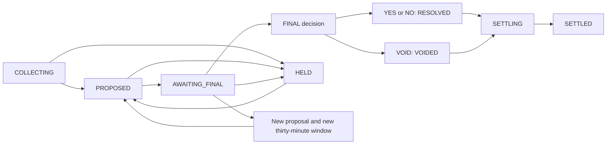

# Resolution and settlement

Status: **proposed; awaiting review**. Date: 2026-10-26.

This is prompt 08's design deliverable. Stop for review before migrations,
collectors, settlement code, endpoints, golden tests or load tests.

The void policy is settled by this prompt: refund remaining holders' exact
average-cost basis, preserve completed sales, refund every charged market
order fee, and transfer the collateral to treasury. Treasury absorbs the
remaining-basis shortfall or receives the surplus. This supersedes older
specification/design notes that left void accounting unresolved; that
policy is not reopened here.

## 0. PRD, existing project and integration

### Product outcomes

| User/system | Required outcome |
|---|---|
| Player | See immutable captured evidence and the current proposal/window; dispute if verified and currently/formerly a holder; receive only committed payouts/refunds |
| Resolver | Collect/add evidence, propose a reasoned YES/NO result, or hold review without automatically making a result final |
| Super admin | Resolve every dispute, independently finalize after the correct window, authorize void and approve a large shortfall with a second person |
| Operator | Resume interrupted jobs, prove every payout/refund once, inspect progress/totals and halt on a financial invariant failure |
| Portfolio/feed | Read committed position_results and truthful phase/status notes; notify a durable participant cohort after positions retire |
| Season scheduler | Finalize only a fully settled season; expose earlier seasons as provisional until then |

The module owns evidence, proposal/dispute/decision history and settlement
orchestration. Ledger remains the only money-moving implementation. It
does not match orders, change closed market economics, reverse finished
trades, decide automatically from a parser, or pay a proposed outcome.

Inspected implementation facts:

- Prompts 01–07 are fully implemented and verified in this workspace:
  - Auth (01) and Ledger (02) manage identities, accounts, sessions, and journaled postings.
  - Markets (03) manages states (`DRAFT` → `ACTIVE` → `CLOSED` → `RESOLUTION_PENDING` → `RESOLVED`/`VOIDED` → `SETTLING` → `SETTLED`), `status_note`, and `approvals`.
  - Exchange (04/05) matching engine and runtime manage `positions` (`qty`, `avg_cost`, `fees_paid`, `realized_pnl`), `Close` actor transitions that cancel resting orders and release holds, and outbox event streams.
  - Live Feed (06) provides WebSocket streaming (`say-stream`) and outbox relay.
  - Portfolio and Notifications (07) created the `position_results` table (migration 013), read endpoints (`/v1/me/portfolio/summary`, `/v1/me/positions`, `/v1/me/results`), and notification fanout pipeline.
- Migration 001 contains legacy baseline `market_resolutions` and `settlement_claims` tables. Migration 014 will cleanly extend `market_resolutions` (adding state, version, proposal/decision pointers, dispute_until, flags) and add append-only tables `resolution_evidence`, `resolution_disputes`, `resolution_decisions`, and `settlement_jobs`.
- Ledger `PAYOUT` already exists. `VOID_REFUND`, `FEE_REFUND`, and `VOID_COLLATERAL_RELEASE` will be added to domain model and PostgreSQL constraint allow-lists.
- Current `kind_allowed` in `season.sl` permits `PAYOUT` only in `CLOSING`/`CLOSED` seasons. A market can resolve and settle during an `ACTIVE` season; settlement kinds will be permitted in `ACTIVE`, `CLOSING`, and `CLOSED` seasons when guarded by a closed market and an immutable resolution decision.
- `post_many` locks user/bot wallets once in deterministic sorted order; system wallets use journal sums and do not hold balance locks.
- `settlement_complete` in `ledger/store/seasons.sl` is an unused placeholder. Prompt 08 implements `season_can_finalize(season)` checking all markets in the season are `SETTLED` with zero unfinished settlement jobs, enabling the `CLOSED → FINALIZED` transition in `tick_tx`.
- Generic `approvals` table (migration 006/009) supports `kind = 'void_shortfall'` for 2-super-admin approval of void shortfalls over S 50,000.

Use `src/resolution/{domain,service,store,server}`. Pure domain includes
state/authorization rules, source interpretation, settlement plans and
checked arithmetic. Service orchestrates through ports; stores implement
PG/fetch/blob adapters; server owns DTOs/registered failures. platform/app
wires stores/services, accounts/approvals/ledger/exchange, config and jobs.
Use zokor feature/route scaffolding after review; no tenant arguments.
Shared transaction store calls are permitted by AGENTS.md; no service or
domain imports pg/httpc or reaches another feature's domain directly.

## 1. Resolution state, immutable history and authority

### 1.1 Two related state machines

Market lifecycle remains separate from its resolution workflow:



The table-driven domain transition function evaluates action, actor,
current version, evidence, proposal, time and dispute facts. States are
COLLECTING, PROPOSED, AWAITING_FINAL, HELD and FINAL. OVERDUE is an orthogonal
flag/filter on COLLECTING past resolve_by with no proposal; it does not
erase the underlying state. Evidence conflict is another flag, not an
automatic outcome/void transition.

| Action | Actor | Guards/effects |
|---|---|---|
| Initialize | internal coordinator | After registry closure/handoff, create COLLECTING and durable capture work once |
| Add/refresh evidence | resolver or super_admin; collector system | Capture through the approved fetch path; append evidence; never propose automatically |
| Propose YES/NO | resolver or super_admin | Nonempty bounded reason, ≥1 complete captured evidence ID for this market; append immutable proposal and evidence links; new window of thirty minutes |
| Hold | resolver or super_admin | Reason; before immutable final decision; preserve earlier proposal/history; no financial effects |
| Window elapses | leader watcher or synchronous due promotion | DB time ≥ dispute_until; PROPOSED→AWAITING_FINAL, even if disputes still need decisions |
| Dispute | verified current/former holder | During active PROPOSED window, before dispute_until; one root dispute per account/market |
| Decide dispute | super_admin | ACCEPT/REJECT and note; append a decision, CAS resolution version, audit/outbox |
| Finalize matching YES/NO | super_admin | Window elapsed; no undecided disputes; finalizer≠proposer; append final decision and settlement job; market RESOLVED |
| Finalize different YES/NO | super_admin | Not a payout decision: append a new proposal with caller as proposer and a new thirty-minute window |
| Finalize VOID | super_admin | Allowed from SUSPENDED/CLOSED/RESOLUTION_PENDING; public reason/code; no window delay; final decision/job, market VOIDED; large-shortfall approval gates financial execution |

Proposal replacement before FINAL, including resuming HELD, creates a new
row and full new window. The old proposal remains evidence of what players
saw. A changed-outcome finalize request cannot reuse an elapsed old window.
The new proposer is the actor who changed it, so that person cannot later
finalize their own replacement proposal.

Hold does not undo an immutable final decision or settled money. After
financial execution starts, corruption stops the job under the invariant
failure path, not by editing the result. Correcting an already paid final
decision requires a separate audited compensating workflow outside this
prompt; it cannot activate another payout job automatically.

### 1.2 Append-only facts and mutable projections

| Object | Authority/constraints |
|---|---|
| market_resolutions | One mutable projection per market: state, version, current proposal/final decision pointers, conflict/overdue flags and hold reason |
| resolution_proposals | Immutable market/terms, proposer, outcome, reason, proposed_at, dispute_until, evidence-set hash and predecessor; evidence-link rows also append-only |
| resolution_evidence | Prompt capture fields plus exact stored bytes/storage identity, parser version/binding and capture status; append-only |
| resolution_disputes | Immutable account/market/proposal, reason/link, holdings proof/snapshot and created_at; unique(account,market) |
| resolution_dispute_decisions | Immutable dispute/proposal, ACCEPT/REJECT, note, decider/time and any superseded decision reference |
| resolution_decisions | Immutable decision UUID, market/season/terms, YES/NO/VOID, proposer/proposal when applicable, finalizer, public reason/void reason and decided_at |
| applied decision binding | One immutable market→applied final decision, unique market; all settlement claims/results must reference it |
| settlement manifests | Immutable frozen allocation/fee/collateral plans and canonical hashes, linked to decision; jobs carry the active pointer |

Revoke UPDATE/DELETE/TRUNCATE on all immutable tables from say_app, overriding
its current broad default grants. Mutable workflow projections/jobs have
explicit CAS versions. Corrections append new facts, never rewrite evidence,
dispute text or final decisions. A trigger/constraint verifies linked market,
proposal, proposer and outcome consistency; a copied proposer field alone
is not sufficient self-finalization defense.

For YES/NO, DB defense verifies a matching proposal, finalizer≠proposer and
elapsed window. A transaction-locked projection checks outstanding dispute
decisions/roles; evidence cannot be borrowed from another market. Before
creating the unique applied decision, recheck all conditions under locks.
Two finalizers racing on one version produce one decision, one job and one
STALE_VERSION, not two independently valid decision IDs paying twice.

Generic approvals remains the shared approvals feature/table proposed in
prompt 03. Do not create a second approval system for void. Its mutable
request status is separate from append-only resolution decision history.

### 1.3 Disputes, replacements and timing

Eligibility comes from verified account state and current or historical
share ownership backed by positions/fills/ledger. An unfilled buy order
alone is not proof someone held shares. Store current free/held quantities
by outcome plus the historical holding proof at submission, so later sales
cannot rewrite what the admin reviewed. Public resolution reads do not
expose other players' identity/holdings/dispute details.

Accept disputes only while PROPOSED **and** DB time < dispute_until; watcher
lag cannot extend the window. Finalization at the exact endpoint may proceed
when time≥dispute_until and all other conditions hold. Lock the resolution
before both submit and finalize so a last-moment dispute cannot be skipped.
Unit tests inject time; actual transactions use database time.

One root dispute per account/market remains true across replacement
proposals. Carry existing roots forward for reconsideration; append a
decision scoped to the new proposal rather than assuming an old rejection
settles a challenge to the changed outcome. A second root submission
returns an explicit already-disputed result. Disputes do not extend a window.
Acceptance records the admin's decision; hold/new outcome is an explicit
authorized action, never an automatic parser/dispute majority vote.

All propose/hold/dispute-decision/finalize paths are synchronous transactions:
recheck actor/roles, compare version, append facts, CAS projection/market,
write audit and outbox, commit, then optional bounded delivery kicks. A due
state promotion can occur inside finalize without waiting for the watcher,
but it does not skip time/dispute/independence checks. Unsupported edges
return INVALID_STATE without modifying the state machine.

Void's specific exemption removes the thirty-minute delay. Existing
undecided-dispute and proposer-independence guards are retained when there
is an active proposal; when none exists there is no proposer to compare.
The large-gap second approver must always differ from the primary void
author. This interpretation is explicit for review; it adds no new void
refund policy or small-gap second-approval requirement.

The required void_reason is exactly POSTPONED, ABANDONED, AMBIGUOUS,
SOURCE_UNAVAILABLE or OTHER, alongside a public explanatory reason. A void
from SUSPENDED/CLOSED initializes the resolution projection if absent;
it does not require an earlier YES/NO proposal or invent a dispute window.

### 1.4 Card/banner truth and public progress

Expose state/version, proposal, actual dispute_until, final decision,
evidence state and settlement progress separately. The countdown represents
time to the **end of disputes**, not guaranteed human finalization/payout.
Proposed notes:

- COLLECTING: Collecting results.
- PROPOSED: Result proposed · Yes · 21m to dispute.
- AWAITING_FINAL: Awaiting final approval, or Result under review if needed.
- HELD: Result under review, with the public reason where appropriate.
- FINAL/job running: Settling · Yes, or Voided · refunds pending.
- Waiting large-gap approval: Waiting on a second approval.
- Completed YES/NO: Settled · Yes won.
- Completed VOID: Voided · refunds sent.

The supplied "final in"/"Settling · proposed" copy needs a label clarification:
there is no financial settlement during a proposal window and no automatic
final result when its timer ends. Never emit "refunds sent" merely because
a VOID decision was recorded. Keep the exact final outcome in a settled
market so SETTLED does not erase whether it was voided.

## 2. Evidence capture, source adapters and storage

### 2.1 Durable, immutable captures

resolution_evidence stores id,market_id,source_id,url,retrieved_at,http_status,
content_type,snapshot_ref,sha256,finding,verdict and collected_by as specified.
For the initial implementation choose inline bytea **up to 2 MiB** so bytes,
hash and evidence fact commit together without assuming an object-store SDK.
Preserve exact captured entity bytes and decoding/content-encoding metadata;
SHA-256 covers exactly the stored bytes. Never truncate a larger response
and call it a complete snapshot. Persist parser/binding version and raw
source facts so a later parser change creates a new interpretation row.

An object-storage adapter can use immutable content-addressed objects later.
Uploading after recording a hash is allowed as asynchronous work only if
the evidence remains non-ready until the durable object is verified. A
missing/failed upload must not satisfy NO_EVIDENCE checks or appear as a
downloadable proof. Inline storage avoids that initial cross-system gap.

Duplicate capture attempts may retain separate retrieval facts while
deduplicating identical blob bytes by hash. A hash proves what was captured,
not that a source verdict or real-world claim is true. Conflict is true
when eligible evidence contains both SAYS_YES and SAYS_NO; UNCLEAR alone
does not create agreement or a result.

Public snapshot_url points to a controlled immutable download/read adapter,
scoped to published market evidence. Serve fetched HTML as inert/downloaded
content with appropriate content-type/disposition/nosniff, not executable
HTML on the authenticated app origin. Source URL and captured hash stay
visible; private notes/credentials are not copied into public snapshots.

### 2.2 Fetch and parse ports

Adapters are separate fetch and pure parse stages:
`fetch(validated_url) -> captured snapshot` and
`parse(snapshot, immutable market terms/binding) -> finding + verdict`.
Collectors never call propose/finalize and never move money.

market.closed creates durable collection work. A bounded long-lived pool
claims due source jobs, fetches outside PG transactions, records completed
captures/audit/outbox and retries with bounded backoff until resolve_by.
Request deadline is ten seconds for the whole network request. After the
request deadline, record a failed attempt and retry within the resolve_by
budget. Automatic retries stop at resolve_by; if there is no proposal,
flag OVERDUE. Authorized manual refresh can still collect evidence later.
No task per retry leaks when a source stays unavailable.

Use the market's approved source definition(s) captured with its terms.
Prompt 03 currently proposes one resolution_source_id; multiple-source
support needs an explicit approved source-binding set, not an invented
list fetched from arbitrary links in a page. Manual URL capture must map
to an approved source/allowed URL pattern, and the server captures/hashes
it; a resolver-supplied digest is not trusted evidence.

Ship a generic capture adapter that returns UNCLEAR. A real football adapter
must parse an actual approved seeded source's final score/status and use
an explicit market binding (fixture/date/parties/regulation rules and a
supported winner/goal predicate). Do not infer a general English question's
truth from a score or fabricate an external JSON endpoint. Bind parser
parameters to approved terms; unsupported/ambiguous/postponed data yields
UNCLEAR. Before implementation's real-parser gate, select/capture the seeded
source's actual schema/page fixtures and verify against its real responses.
No such source fixtures exist locally yet, and no real parser is claimed
from a synthetic fixture alone.

### 2.3 Verified HTTP capabilities and fetch boundaries

`slangc doc httpc Request/client_send` confirms method/url/headers/body,
max_redirects and ca_path, plus Client.send with a deadline. Current local
stdlib docs/source use net.dial_until/tls_dial_until, correcting the older
auth note's source-level connect-deadline limitation; deployment/compiler
behavior still needs actual timeout tests. No Request.max_body_bytes,
custom resolver hook or S3 client is invented.

The inspected HTTP client has a fixed 32 MiB response/decompression ceiling,
not a per-request 2 MiB setting. Initial bounded collectors can reject
responses over 2 MiB before evidence persistence, but must budget that larger
temporary fetch allocation. A strict 2 MiB network-memory ceiling requires
a verified bounded streaming adapter/SDK extension before claiming it.

Require approved HTTPS origins, reject credentials/local/private/link-local
targets, and disable redirects initially with max_redirects=0. DNS/egress
checks must apply at the actual connection boundary to avoid a check/use
gap; use an explicitly restricted fetch adapter/network policy rather than
assuming URL text checks prevent private-network access. No app cookies,
session tokens or arbitrary auth headers are forwarded. HTTP failures and
timeouts are capture-attempt facts, not positive YES/NO verdicts.

## 3. Settlement plan, jobs and exact postings

### 3.1 Close proof, frozen manifest and independent execution

After a final decision, a durable settlement job first proves runtime Close:
committed Close/closed read state, no resting orders, no PENDING admissions
that could create order exposure, and no open holds for this market.
Registry CLOSED/VOIDED alone is not that proof. A void initiated from
SUSPENDED first blocks trading and asks an exchange-service coordinator to
ensure durable Close/drain; job waits. The financial workers never send to
an actor, match orders, or wait for WebSockets/Redis. Releasing order holds
is prerequisite Close work, not an unauthorized void refund before approval.

Freeze a consistent allocation manifest after closure/reconciliation:
decision/policy/season; each account/outcome's qty, remaining basis, realised
P/L and charged fees; actual fee-paying order/charge IDs; initial supply
and collateral; and canonical totals/hash. Positions are verified
projections of immutable fills/ledger, not a second authority for arbitrary
refund amounts. Verify basis and realised history as well as wallet qty.
The job does not consult changing prices/evidence to decide payments.

All financial owners are included, including bots or accounts later
suspended/deleted from sign-in eligibility. Notification/email eligibility
cannot remove a financial entitlement. Freeze fee-only/sold-out participants
too: they may have qty=0 and still require fee refunds/results.

Retries always build the same postings from the frozen manifest, not current
positions that earlier batches already cleared. No ordinary share/order
adjustment may change this market after freeze. A detected change before
any financial post requires a new immutable manifest and stale approvals;
after execution starts it is an invariant stop, not silent replanning.

The job can use verified position/order/fill projections to allocate, but
the decision and journal establish outcome/payment authority. "Reads only
decision and ledger" must not be interpreted as ignoring the remaining-basis
and holdings projections explicitly required by this prompt.

### 3.2 Job structure and bounded batches

One job per market/applied decision has CAS version, state, manifest pointer,
cursor, done, totals, retry/error and approval pointers. Suggested states:
WAITING_CLOSE, PREPARING, WAITING_APPROVAL, RUNNING, VERIFYING, DONE and
INVARIANT_FAILED. Do not overload registry lifecycle with job failure labels.

Create deterministic account batches of **at most 500 accounts per
transaction**, with separate batch claims/leases and a default pool of four
workers. Each batch uses one ledger post_many over its complete wallet set,
then writes immutable results, clears settled position qty/basis and records
claims/progress/private outbox events in the **same transaction**. One result
cannot commit without its financial posting, or vice versa. A zero-qty/no-cash
result is recorded without a fictitious zero-entry ledger transaction.

Fee refunds may involve far more than 500 orders for one account. Use
bounded per-order fee work batches in a separate phase, retaining the exact
fee_refund key; an account's final void result is not published until all
its fee refunds are confirmed. Then principal refund/burn/result commit
together. Account count alone is not a bound on fee-posting/output size.

Workers claim disjoint deterministic work and verify lease generation under
the batch row lock. A stale claimant cannot advance progress. Parent cursor
advances only over contiguous completed batches, not the greatest finished
cursor. Parent totals derive from unique completed work/actual postings;
replays cannot add the same amount twice. Two job starts converge on the
same decision/job/claim constraints.

Lock order: season share lock, market/active-decision shared guard, job
guard, batch/claim, then ledger's sorted user/bot wallet union. Coordinators
take exclusive market/job locks for phase transitions only; do not hold an
exclusive market or shared-system-wallet balance lock across every payout
batch, which would serialize the four workers. Keep query/pool deadlines
and bounded settlement capacity separate from live trading reservations.

### 3.3 Business keys and once-only application

| Movement | Key / binding |
|---|---|
| YES/NO burn and payout | settle:{decision_id}:{account_id}:{outcome} |
| Void basis refund and burn | void_refund:{decision_id}:{account_id}:{outcome} |
| Whole collateral transfer | void_collateral:{decision_id} |
| Per-order fee reversal | fee_refund:{order_id}, exactly as specified |

Every posting sets season_id/market_id and ref_type=resolution_decision,
ref_id=immutable decision UUID. ref_id is included in the ledger's canonical
hash; metadata alone would not bind it because metadata is intentionally
excluded. Fee-refund claims link the original FEE charge/order and decision,
with uniqueness on the original charged order.

**Key wording conflict:** the specific fee_refund:{order_id} format is an
exception to the ground rule saying every key contains decision_id. Preserve
the explicit per-order key, bind its canonical payload/ref/claim to the
decision, and flag a different-decision retry as a conflict. One immutable
applied decision binding prevents changing decision IDs to pay the market
again. This is an implementation clarification, not a new refund policy.

Existing post_many checks matching business-key payloads and does not post
them again. Job/result/claim uniqueness must cover the surrounding writes
too; business keys alone do not make repeated result inserts/progress
increments safe. Unknown COMMIT outcome is resolved by decision/job/claim
and journal hash on a fresh connection before retrying, not assumed rollback.

### 3.4 Ledger phase/season integration

Extend domain and DB kind allow-lists for VOID_REFUND, FEE_REFUND and
VOID_COLLATERAL_RELEASE; PAYOUT already exists. Allow these settlement
movements in ACTIVE, CLOSING and CLOSED seasons under an applied immutable
decision and closed-market proof. FINALIZED remains closed to new financial
settlement writes. Always take a season share lock so finalization cannot
race an admitted settlement batch. Settlement is allowed during a global
trading halt unless its own decision/manifest invariants fail; halting new
trades must not trap valid payouts.

Use the existing ledger batch interface; do not call post separately for
500 accounts and acquire wallets in 500 independent orders. System owners
use journal sums, never their intentionally zero cached free/held fields.
No direct UPDATE of wallet balances or DELETE of shares/ledger entries
implements a payout or burn.

### 3.5 YES/NO wins

For account A, outcome O, quantity q>0:

- Burn: A.free(O:market) −q; system:shares:market.free(O:market) +q.
- If O wins: system:collateral:market.free(SEDI) −qV;
  A.free(SEDI) +qV.
- If O loses: no SEDI entries; its share burn is still a balanced PAYOUT.
  Never emit zero monetary entries/hold operations.

In the same account batch write position_results with frozen qty/basis/fees,
paid_out=qV for winners or zero for losers, and
`pnl=paid_out+realized_pnl_from_sells−cost_basis−fees`.
Record result WON/LOST from the decided outcome, not the sign of net profit.
Clear current position qty/basis while retaining immutable result/history.
Keep fee_paid charge history intact; normal settlement does not refund it.

Golden normal cases:

- V=100: ten YES with basis400 and fee1 pay1000, P/L +599. Matching ten NO
  with basis600 and fee1 pay0, P/L −601. Collateral1000 becomes0; both
  outstanding share supplies become0; the S2 charged fees remain fees.
- V=200: three NO bought at80 have basis240, fee1 and payout600, P/L +359;
  opposite YES basis360,fee1 lose, P/L −361. The engine is not hardcoded
  to V=100.

### 3.6 VOID flows and safeguard

Define frozen C=initial collateral, R=sum of **remaining principal basis**,
F=sum of actual S1 market order fees, and P=issued pairs.

```text
C = V * P
treasury_delta = C - R
shortfall = max(0, R - C)
total_user_cash_returned = R + F
```

F is refunded from system:fees, **not** added to the treasury shortfall.
This distinction is required by the worked example: its gap is50, not54.
Overall treasury balance can change due to other markets; approval binds
this market's obligation/plan, not a volatile global treasury balance.

Refund the exact stored remaining integer basis B, not a rounded displayed
average multiplied by quantity Q. Preserve average cost as B/Q: Q=3,B=101
refunds101, not99. Runtime's proposed partial-sale rule removes floor(B*k/Q)
and retains rounding residue in the remaining B; reuse that verified basis
history rather than recalculate a different sale allocation at void time.
Use checked wide intermediates and fail before posting on overflow.

Before any void financial posting, require the frozen manifest and, if
shortfall is **over** the configured S50,000 threshold, a matching approved
generic approvals row of kind void_shortfall from a different super admin.
Exactly50,000 does not cross the default threshold. Bind approval hash to
decision, manifest allocations/C/R/F/treasury_delta, terms and threshold
policy version; stale/different payload cannot authorize execution.

The primary void decision/job may exist while waiting on Close or that
approval. No collateral transfer, fee refund or basis refund occurs before
the approval gate passes. A waiting job reports VOID_NEEDS_SECOND_APPROVAL;
it does not claim refunds sent. Proposed additional API for actually making
the second approval is listed in §4, since prompt 10 supplies UI, not this
backend capability.

Approved void phases:

1. VOID_COLLATERAL_RELEASE once: collateral SEDI −C, treasury SEDI +C.
2. FEE_REFUND once per actually charged order: fees SEDI −1, original
   account SEDI +1, including sold-out accounts and buy/sell orders.
3. VOID_REFUND per remaining account/outcome: treasury SEDI −basis,
   account SEDI +basis, account outcome −q, system:shares outcome +q.
   A zero basis means no zero SEDI entry, while a positive-q burn remains.
4. Commit result with result=VOIDED, paid_out=principal refund and
   `pnl=realized_pnl_from_sells+fees_refunded−fees`. Add fees_refunded and
   decision/journal references to position_results so paid_out is not
   confused with total cash including separate fee credits.

Zero-inventory fee-only participants also get their completed fee/result
evidence, with principal paid_out=0. Do not derive them from qty>0 rows.
Finished sale profit/loss stands; remaining principal return cancels its
remaining basis exactly. Treasury can have a negative **net change** under
this authorized policy; record actual balance/gap separately and leave
funding operations to prompt 09. Do not silently mint credits or charge
holders to remove the gap.

### 3.7 Fully worked void example

Use V=100 and illustrative initial cash1000 for A, B and C; treasury,
market collateral and market fees start at0. Initial grants have their
normal issuance offset; it is unchanged throughout this example.

1. A buys one YES40, B buys one NO60 in a mint. Each pays fee1.
   Collateral100; A holds YES1/basis40; B holds NO1/basis60.
2. A sells YES1 to C at90. A and C each pay fee1 on those new orders.
   A is sold out, realised principal P/L=+50, total fees2.
   C holds YES1/basis90/fee1; B still holds NO1/basis60/fee1.
3. Close is committed, all residual holds are zero, and VOID is final.
   Freeze R=150,C=100,F=4,treasury_delta=−50. No second approval is
   required at the default50,000 threshold.

Balances, after each completed phase (free cash; no residual holds):

| Phase | A | B | C | Collateral | Fees | Treasury |
|---|---:|---:|---:|---:|---:|---:|
| Initial | 1000 | 1000 | 1000 | 0 | 0 | 0 |
| Mint and first fees | 959 | 939 | 1000 | 100 | 2 | 0 |
| Secondary sale and fees | 1048 | 939 | 909 | 100 | 4 | 0 |
| Collateral release | 1048 | 939 | 909 | 0 | 4 | 100 |
| Fee refunds A2/B1/C1 | 1050 | 940 | 910 | 0 | 0 | 100 |
| Basis refunds B60/C90 | **1050** | **1000** | **1000** | **0** | **0** | **−50** |

Each row sums to3000. In the complete journal the original issuance offset
balances that initial amount. Principal refund entries debit treasury150
and credit B60/C90; collateral release credits treasury100; separate fee
refunds debit fees4 and credit A2/B1/C1. Every posting balances per asset.

Shares before void: C.YES1/B.NO1, system:shares YES−1/NO−1. VOID_REFUND burns
each remaining share by moving it back to system:shares, leaving all
outcome wallet balances and both supply offsets0. No historical sale is
reversed and A is not charged back its sale proceeds.

| Result row | qty at void | Basis | Principal paid_out | Fees / refunded | Realised sells | P/L |
|---|---:|---:|---:|---:|---:|---:|
| A / YES | 0 | 0 | 0 | 2 / 2 | +50 | **+50** |
| B / NO | 1 | 60 | 60 | 1 / 1 | 0 | **0** |
| C / YES | 1 | 90 | 90 | 1 / 1 | 0 | **0** |

A's cash gain50 is funded by treasury's net debit50. B and C break even.
An account's VOID paid_out is principal refund, while total credited cash
also includes its separate fee refunds. This table becomes a golden ledger/
position_results test after review; the design arithmetic was independently
checked without implementing settlement code.

Also test surplus: if A instead sells its YES to C for10, remaining bases
are10+60=70, collateral100 gives treasury **+30**, A retains realised **−30**,
B/C break even after fee refunds. The policy preserves finished losses too.

### 3.8 Phase-aware reconciliation and completion

Do not retain the pre-settlement `YES=NO=pairs` check unchanged during
parallel account burns. A batch can burn winning and losing shares at
different rates legitimately. Reconcile in one consistent DB snapshot
against the immutable initial plan and actual settlement journal:

- Always: each asset balances per posting; non-system balances are
  nonnegative; wallet/share projection and result/claim references agree;
  original charged fees remain unique historical facts.
- YES/NO job: remaining winning supply=P−burned_winner;
  collateral=V*(P−burned_winner). Remaining losing supply=P−burned_loser
  can differ temporarily. No unauthorized mint/transfer is permitted.
- VOID job: collateral=C−confirmed_collateral_release; each remaining
  outcome supply=P−confirmed_burns_for_that_outcome. Compare confirmed
  principal/fee refunds and treasury/fee deltas with the manifest, not a
  fictitious live paired-collateral invariant after release.
- DONE: collateral=0, YES supply=0, NO supply=0, no market holds/orders or
  unfinished financial work, and every expected result/refund/claim matches.

After all batches commit, a coordinator takes the final guards, recomputes
checks from journal sums, and only then CASes job DONE and market SETTLED,
with audit/outbox. Failure sets existing trading_halted and alerts; do not
mark settled, silently repair history or announce payouts complete.
Per-account committed payout/read-model events may precede global completion,
but final market.settled/notification fanout waits for verified completion.

### 3.9 Season finalization hook

Wire a transaction-aware season_can_finalize into ledger's actual tick
path, not only its unused placeholder. For CLOSED seasons, check all
required markets SETTLED, no unfinished settlement jobs, no holds and
successful completion evidence. CAS CLOSED→FINALIZED, set finalized_at,
audit and emit season.finalized once. The existing service report/metrics
must include this new transition. Finalization's exclusive season lock
waits for payout batches' season share locks; no new batch can post after
FINALIZED. Active/new-season trading remains independent.

**Eligibility edge for review:** literal "every market" includes never-opened
DRAFT/REJECTED/CHANGES_REQUESTED rows, whose lifecycle has no settlement path.
Safe initial behavior is to keep the season provisional rather than silently
exclude them. Review must define archival/asset-free exclusion or another
explicit disposition before those seasons can finalize. No financially
exposed or unfinished market may be excluded. An empty closed season can
finalize when all no-exposure/job/hold checks pass.

## 4. HTTP contracts, previews and events

### 4.1 Permission matrix and routes

| Capability | Resolver | Super admin | Verified holder | Anonymous |
|---|---|---|---|---|
| Admin queue/detail/progress | Yes | Yes | No | No |
| Manual evidence/refresh/propose/hold | Yes | Yes | No | No |
| Decide disputes/finalize/void | No | Yes, independence rules | No | No |
| Approve large void gap | No | Different super admin | No | No |
| Public resolution/evidence | Public published market | Public | Public | Public |
| Raise one timely dispute | If independently eligible | If independently eligible | Yes | No |

Bare admin/curator/treasury is not resolver/super_admin by implication.
All admin endpoints require session plus the resolution authorization
function; public GETs use deliberate public route markers, while dispute
POST requires session, verification and ownership-history eligibility.

| Endpoint | Required behavior |
|---|---|
| GET /v1/admin/resolutions?state= | COLLECTING/PROPOSED/AWAITING_FINAL/HELD/OVERDUE filter; market,state,stage_label,meta,conflict; bounded keyset pagination |
| GET /v1/admin/resolutions/{market} | Timeline,evidence,disputes,current proposal/window,version and preview |
| POST .../{market}/evidence | url,note; validate/queue system capture, not trust uploaded text/hash as evidence |
| POST .../{market}/evidence/refresh | Queue bounded durable approved-source refresh |
| POST .../{market}/propose | outcome YES/NO,reason,evidence_ids,version; append proposal/window |
| POST .../{market}/hold | reason,version; CAS hold before FINAL |
| POST .../{market}/disputes/{id}/decide | ACCEPT/REJECT,note; append decision and protect current projection version |
| POST .../{market}/finalize | YES/NO/VOID,void_reason?,reason,version; matching final decision or explicit replacement proposal |
| GET /v1/admin/settlements/{market} | Job/phase/manifest/approval/progress/confirmed totals, not a fabricated completion percentage |
| Proposed POST /v1/admin/settlements/{market}/approve-void-shortfall | approval_id,expected approval/job version; distinct current super admin approves the exact manifest hash |
| GET /v1/markets/{id}/resolution | Public state,proposal/window,evidence summary/hash/download link and immutable final outcome/reason/time |
| POST /v1/markets/{id}/disputes | reason20–500 chars,optional link; one per verified current/former holder in window |

Decision/hold handlers are synchronous; evidence network work is asynchronous
after a durable capture request. Finalize must distinguish "new proposal
and new window" from FINAL, and "final decision accepted/job waiting" from
SETTLED. Proposed VOID response can be202 with decision/job and blocking
code when waiting on Close/second approval; do not return a bare failure
that conceals an already committed final decision. No financial payout is
promised by that acknowledgement. API.md will fix exact response examples.

The dispute-decision request currently lacks a version in the prompt. Add
an expected resolution/dispute-decision version (or equivalent If-Match)
to enforce its stated CAS requirement; do not silently use last-write-wins.

### 4.2 Preview and privacy

Before freeze, preview is a coherent read of current verified positions/
fees/collateral, explicitly nonbinding. YES/NO preview includes winning
share count, winner-account count, payout total and burns by outcome.
VOID preview separates principal refunds, fee refunds, collateral released,
treasury delta and shortfall/approval requirement. Recompute/freeze in job
preparation; a displayed preview never authorizes a changed plan.

After freeze, preview displays original manifest obligations plus confirmed
progress; re-reading already-cleared positions must not shrink the original
plan. No private account-level results/disputes are broadcast publicly.
market.settled public event is aggregate; durable per-account result references
route to authenticated private notifications/fanout. This satisfies the
requested account-specific notification copy without exposing portfolios.

### 4.3 Errors and events

Register WINDOW_OPEN (dispute_until), DISPUTES_UNDECIDED,
PROPOSER_CANNOT_FINALIZE, NOT_SUPER_ADMIN, STALE_VERSION, NO_EVIDENCE,
INVALID_STATE and VOID_NEEDS_SECOND_APPROVAL. Reuse existing auth/not-found/
bad-request/unavailable codes; add typed already-disputed/holder-ineligible
and capture failures where necessary. Unexpected store/fetch errors are
logged through bounded signals, never sent as SQL/provider details.

Outbox event set: market.result_proposed, admin-only market.dispute_raised,
market.resolved, market.voided, market.settled and resolution.overdue;
also versioned hold/window/capture/progress/status events as needed.
Payloads bind market/resolution version, proposal/decision IDs, timestamps,
public reason and audience. Private account results use existing per-account/
sharded delivery contracts, not a public array of player P/L.
Insert source events with the corresponding state/job/result transaction;
after-commit kicks are optional. Redis outages cannot lose settlement work,
timer advancement or the final notification cohort.

## 5. Concurrency and supervision

| Work | Execution |
|---|---|
| Evidence collectors | Bounded long-lived pool; durable due jobs, network outside transactions, capture facts committed atomically |
| Dispute-window watcher | One active advisory leader; indexed due PROPOSED windows, CAS/audit/outbox; catch up on boot |
| Overdue watcher | Leader/partitioned bounded scan; one alert per logical overdue condition, remains COLLECTING |
| Settlement workers | Four by default, durable disjoint batches, ≤500 accounts/transaction, one ledger post_many/batch |
| Completion/finalization coordinator | Verifies all work and phase invariants before final state/season transition |
| HTTP propose/hold/dispute-decide/finalize | Awaited synchronous CAS transactions, never detached |
| Outbox kicks/metrics/object upload if configured | Bounded optional hints/tasks; no ready evidence or paid result claimed before durable completion |

Use verified top-level spawn arguments, bounded channels and select/default
for nonblocking hints. Panicked workers need supervision and expired claim
recovery; a discarded spawn result is not automatic restart. Do not hold
service mutexes over PG/network I/O. Respect global lock order, statement/
pool deadlines and one-post-many-per-transaction constraint.

Financial workers never call a market actor. The preparation coordinator's
durable Close request is the only exchange-control dependency, completing
before financial execution. Different markets keep trading while settlement
tasks park on PG. Shared user cash wallets can still contend with live
orders, so "system wallets are insert-only" is not proof of zero latency
impact. Measure that impact with common accounts as well as disjoint users.

## 6. Migration and verification plan after review

Forward migrations must cover:

- Extend the baseline market_resolutions projection with states/version/
  pointers/flags and preserve any real legacy evidence/decision provenance.
- Append-only evidence/blobs/proposals/links/disputes/dispute decisions/
  resolution decisions/applied-decision binding/settlement manifests.
- Settlement job/batch/account/fee work and claims; consolidate existing
  settlement_claims rather than leave a second once-only mechanism unused.
- Extend position_results with decision/fees_refunded and journal references
  consistent with prompt07; support fee-only sold-out result records.
- New ledger kinds and guarded ACTIVE/CLOSING/CLOSED settlement eligibility;
  phase-aware recon and CLOSED→FINALIZED scheduler wiring.
- Generic void_shortfall approval validation/indexes; due-window/overdue/
  batch/progress/market/account lookup indexes and immutable-table privilege
  revocations. Audit all human changes and financial phase transitions.

No destructive dev reset, invented history, schema mutation at startup or
direct wallet adjustment is authorized. Read all configuration once: source
timeouts/pool/retry bounds, body/storage budgets, worker/batch sizes,
threshold/policy version and watcher intervals. Thirty-minute disputes are
the product rule, not a request-controlled setting.

Required tests:

- Exact YES V100 and NO V200 cases; full void example balances/results/fee
  orders/treasury−50, plus surplus and fractional remaining-basis cases.
- Sold-out, both-outcome, bot and disabled-account entitlements; all fees,
  including earlier sell orders; no zero-entry payouts or double fee refund.
- Two parallel starts/finalizers, batch/lease races, crash before/after
  posting/result/progress/COMMIT acknowledgement, and complete replay.
- Phase-aware mid-job reconciliation permits legitimate unequal residual
  supplies; injected wrong quantity/basis/fee/collateral halts trading.
- Window before/exact/after boundaries, own proposal (including replacement)
  finalization forbidden, late dispute versus finalizer race, one dispute
  across replacement proposals and all undecided disputes blocking finality.
- Different YES/NO finalize outcome creates a fresh window and no payout;
  VOID from SUSPENDED waits for proven Close/drain and all holds clear.
- Shortfall50,000 versus50,001, wrong approver/manifest/hash/role, stale
  approval, and no void posting while approval is pending.
- Raw-SQL evidence/decision/dispute UPDATE/DELETE refused; stored-byte hash
  verification, changed parser facts append, conflicting verdicts flagged,
  manual URL/redirect/oversize/timeouts and real seeded-source fixtures.
- OVERDUE and window watcher restart/two-instance behavior; collector never
  proposes; uploads cannot make missing snapshots look ready.
- Final season transition only after its last required settled market/job,
  never while batches hold season locks; terminal event emitted once;
  past-season standings remain provisional until then.
- Public/private evidence/result routing and notification discovery after
  positions retire, including fee-only accounts; countdown/copy never
  announces finality or refunds before the relevant fact commits.

Measure10,000-holder settlement<30 seconds with declared outcome/fee-order
count, batch/pool sizes, SQL/journal time, retries, memory and actual trading
p99 before/during/after. Include same-account live trading, not just disjoint
wallets. Separate Close/approval wait, financial execution, invariant
verification and notification delivery. No benchmark proves unchanged p99
without reporting sampling/noise/hardware/compiler/DB configuration.

Design-stage baseline checks (2026-10-26):

- Whitespace check passed for this new document; worked-example arithmetic
  was checked independently without adding settlement code/tests.
- `zokor check` passed for the existing eighteen packages. `make build`
  passed, with existing generic-instantiation/OpenSSL deprecation warnings.
- Required `make check` stopped at the existing email test
  `test_should_time_out_a_send_to_an_unreachable_provider`: the sandbox
  returned `dial 10.255.255.1: Operation not permitted` instead of a timeout.
  DB/Redis integration and opt-in ledger load tests skipped without their
  configured test settings. No resolution implementation or benchmark is
  validated by these baseline checks.

## 7. Review decisions and later work

| Decision | Proposed implementation clarification |
|---|---|
| R1: Policy | Prompt08 void rules supersede older unresolved notes; no reversal of past sales or withholding fee refunds |
| R2: Immutable state | Append proposals/disputes/decisions; separate CAS projections and dispute decisions; one applied final financial decision |
| R3: Void permissions | Window exemption only; preserve existing-proposal independence/dispute guards and distinct second admin for large gap |
| R4: Execution | Prove Close/drain first, freeze a ledger-verified manifest, include fee-only participants, one post_many per bounded batch |
| R5: Approval | Hash exact obligations/decision/threshold; no void movement before large-gap approval; add a backend second-approval route |
| R6: Keys | Keep required fee_refund:{order} exception, bind decision in canonical ref_id/claims, prevent new-decision double payout |
| R7: Ledger phases | Allow authorized settlement in ACTIVE seasons; reconcile phase-aware residual supplies/collateral; final checks all zero |
| R8: Evidence | Inline immutable ≤2 MiB baseline, explicit real-source binding/fixture gate, bounded fetch and safe inert snapshots |
| R9: UI/privacy | Distinguish dispute deadline from human finalization; do not publish account result arrays or claim refunds while waiting |
| R10: Finalization | Wire actual ledger scheduler transition; define never-opened asset-free market disposition explicitly before excluding it |

After review: dependency contracts/migrations, source fixtures/adapters,
state/permission/dispute handlers, manifests/approvals/ledger kinds, resumable
jobs, phase reconciliation/finalization, then golden/fault/load gates and
docs/resolution/API.md. Prompt09 provides treasury funding dashboard/actions;
prompt10 provides the approvals inbox UI. Those UIs do not substitute for
the backend authorization and once-only accounting required here.
