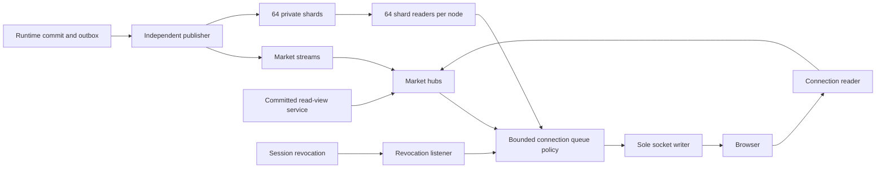

# Live feed: gateway protocol and recovery design

Status: **proposed; awaiting review**. Date: 2026-10-26.

This is prompt 06's design deliverable. Review precedes gateway code,
client-library code and fault/load tests. No WebSocket gateway, exchange
runtime or stream delivery is claimed as implemented by this document.

## 0. PRD, dependency state and verified framework

### Product requirements

The feed gives visitors current public markets and gives signed-in users
their private account changes. A client must distinguish a complete book
from a stale or incomplete one. A slow or disconnected browser must never
delay the exchange actor, a ledger commit, or another subscriber.

| Consumer | Required outcome |
|---|---|
| Home page | Batched cards at most once per second, with truthful nullable stats |
| Market page | Top-50 Yes book, a mirrored No view, recent trades and current status, with explicit gap/reset handling |
| Signed-in user | Own order/balance/position events; no silent private loss; logout revokes access promptly |
| Client integrator | Typed TypeScript events, reconnect/resubscribe, BookMirror, bounded buffering and REST reload hooks |
| Operator | Bounded memory/queues, observable lag, recovery from Redis/hub failures and measured healthy-client latency under slow-reader load |

The gateway reads streams, authorized identity and committed read views;
it never writes to ledger, wallets, orders or actor mailboxes. Public
subscription or resync is not an order-admission request. PostgreSQL remains
authoritative for money/authentication; Redis and all gateway book copies
can be rebuilt.

Current workspace has auth and ledger code. The registry, matching core
and runtime remain **proposed** documents under docs/markets and
docs/exchange. There are no working market streams or BookView services
to consume. The existing platform publisher sends outbox rows to say:events,
and auth does **not** yet publish session.revoked. Dependency changes below
must be implemented and tested after review; no fake completed backend is
assumed.

Use `src/stream/{domain,service,store,server}`. Domain contains pure protocol,
merge and cursor rules; service owns hubs/subscription/buffer orchestration
through ports; store supplies Redis and authorized read adapters; server
owns the upgrade, DTOs and registered errors. platform/app wires services,
configuration and workers. The TypeScript package is explicitly requested
client code, not a change to the slang/zokor server stack. There is no
existing TypeScript workspace/package configuration to extend.

### What was verified

`slangc doc zokor` was queried one exported item at a time. The dependency
in slang.lock is zokor v0.2.0, content hash
`3f41f1692182186f373063e9fcbf6d389f9c463daacd24c7373374f51b5b1b6d`.
Its cached ws.sl, ws_serve.sl and socket.sl were read/compared and match
the inspected sibling files. These are verified APIs, not proposed names:

| Capability | Existing API/behavior |
|---|---|
| Route and upgrade | Router.websocket(path, open, WsRoute); zokor.ws_route(rules,message).on_close(closed); handshake Ctx.socket() and Ctx.accept_ws() |
| Incoming callback | fn(App, zokor.Socket, zokor.Message) receives Text/Binary; parser handles Ping/Pong/Close internally and on_close reports termination; framework decodes framing and UTF-8 |
| Outgoing | Socket.send_text(str), send_binary(bytes), close(code,reason) return bool; framework's single writer owns transport sends |
| Limits | WsRules.max_frame_bytes and max_message_bytes separately limit a frame and assembled fragmented message; max_queue counts messages only |
| Heartbeat | ping_interval and pong_timeout are nanoseconds; native WebSocket heartbeat waits for silence, not a fixed periodic ping under active traffic |
| Sans-I/O | new_conn(rules), receive(conn,bytes), pending(conn), text_frame, ping_frame, pong_frame, close_frame and close_because |
| Failure behavior | Queue overflow currently closes immediately with local code 1008; close queues behind existing data and may fail to queue a close frame when full |
| Protocol errors | Existing close_because emits 1002, including oversized-message errors; 1006 is a local observation, never an outgoing close code |
| Redis | redis.do(conn,args,deadline) supports XREAD as raw command arguments; its recv path uses deadline-aware network calls that park the task, not the worker |

See the prompt-06 addition to docs/auth/slang-notes.md for exact source
locations. No native try_send, select timeout arm or atomic-reference swap
is invented; use the verified select/default, timer and mutex patterns.

**Framework prerequisite:** the existing served Socket queue cannot express
the required 1 MiB cap, queued-message replacement/coalescing, reserved
control delivery, ten-second slow-consumer policy or priority revocation
close. Its default write timeout is also ten seconds, inconsistent with
prompt revocation interruption. Proposed resolution is an opt-in zokor
queue/writer-policy hook, preserving two long-lived connection tasks and
the existing parser. Its contract is described in §2.1, not presented as
an API that already exists. Do not hide another application queue/pump
behind Socket.send_text and claim the resulting hidden queue satisfies
the byte cap. Do not alter dependency code before this review.

## 1. Protocol and authorization

### 1.1 Upgrade, identity and limits

Endpoint is GET /v1/stream over WebSocket. It is public on purpose at the
HTTP boundary; optional session authentication binds a server-derived
account/session identity. Signed-out visitors can use public channels.
The me operation separately requires a valid bound identity; do not place
an unconditional require_session guard on all upgrades.

Browser uses the existing say_session cookie. Mobile may use ?token= with
the same opaque session token. Apply cookie precedence consistently with
platform/auth; reject conflicting identities rather than letting query
data switch the account of an authenticated socket. An absent/expired
credential can establish an explicitly anonymous public connection; it
never authorizes me. Malformed credentials fail with a registered error.
Opening handshake identity includes the DB sessions.id and expires_at;
current cached Session exposes only account_id/token_hash, so auth needs
an authoritative projection rather than inventing an exposed session ID.

Origin matches an exact configured scheme/host/port allow-list. A missing
Origin is accepted only under an explicit mobile/CLI policy, requiring
token authentication for private access; cookie-authenticated browser
connections do not bypass Origin checks. Read settings once in platform/config.
Tokens must be redacted from request logs/traces/errors and never retained
in connection-local display data. Test redaction with a sentinel token;
do not assume the framework's raw-path logging already strips it.

Per connection: 50 unique channels, 20 subscribe operations in ten seconds,
16 KiB maximum inbound frame **and assembled message**, and 256 outbound
messages or 1 MiB, whichever binds first. Reject binary application input
with 1003; malformed JSON/op/channel gets a typed protocol error. Rate-limit
resync and general control traffic too, with explicit configurable caps,
so repeated resync cannot start unbounded snapshot jobs. Oversize rejection
uses verified parser limits; adopting 1009 rather than current 1002 needs
a tested typed error mapping, not a claimed existing behavior.

Server sends WebSocket control pings on a twenty-second schedule and closes
after sixty seconds without valid inbound activity. Pongs count as activity;
outbound market traffic does not. Text `{op:ping}` gets an application pong
through the same writer. The framework hook must distinguish scheduled
heartbeats from its current idle-only behavior and wake shutdown checks
promptly. A shared node timer handles housekeeping; no permanent extra
timer task per connection is needed.

Close codes: 1000 normal, 1001 shutdown, 1002 protocol, 1003 unsupported
binary, 1008 policy, 1011 internal failure, **4001 session revoked** and
**4008 slow consumer**. A non-reading/broken peer may never observe a close
frame; the server must still terminate and free the connection by deadline.

### 1.2 Operations and event envelope

Client operations are subscribe/unsubscribe with channel arrays, resync
with one channel, and ping. Subscription identity is idempotent. Validate
syntax/count before allocation; authorize each requested channel and
acknowledge accepted channels plus typed per-channel rejections. An invalid
me subscription does not turn an anonymous public socket into a private
one or destroy its valid public subscriptions.

Server envelope contains event_id, channel, type, ts, payload and optional
book_seq/from_seq/owner_epoch. Market IDs are actual canonical UUIDs from
the registry; m_123 in the prompt is illustrative, not a second ID format.
Internal account IDs, owner groups, holds, sessions and ledger entries
never appear in public envelopes.

**Integer representation proposal:** encode book_seq, from_seq and
owner_epoch as canonical decimal strings, parsed as bigint by the client.
The server's integers are 64-bit; JavaScript numbers cannot represent every
possible value exactly. Apply the same rule to unbounded quantities/volume;
small validated prices/V remain numeric integers. This changes the prompt's
illustrative JSON and requires review. Do not silently parse unsafe JSON
numbers or compare sequence strings lexicographically.

For a single delta, the next sequence is last+1. For a merged delta define
**from_seq as the previous/base sequence**, exclusive: from_seq=1090 and
book_seq=1092 covers updates 1091 and 1092. A client may apply it iff its
current seq equals from_seq and epoch matches. Omitted from_seq means
book_seq−1. This makes the supplied envelope example unambiguous and
replaces the naive last+1 check for merged client frames.

Durable events keep their source event_id and commit timestamp. Synthetic
snapshots/resets/merged frames have distinct gateway event IDs; book sequence
and epoch remain the completeness proof. A merged frame cannot reuse a
source ID already consumed by the client LRU.

Example proposed merged frame (illustrative values, decimal-string sequence
and quantity fields):

```json
{
  "event_id": "merge_example_1090_1092",
  "channel": "market:123e4567-e89b-42d3-a456-426614174000:book",
  "type": "book.delta",
  "from_seq": "1090",
  "book_seq": "1092",
  "owner_epoch": "7",
  "ts": "2026-10-26T12:00:00Z",
  "payload": {
    "depth": 50,
    "levels": [{ "side": "ask", "yes_price": 58, "qty": "12" }]
  }
}
```

The receiver must already be at epoch 7/seq 1090. This frame advances it
to 1092; it does not represent an increment of twelve shares.

### 1.3 Channels

| Channel | Authorization and payload contract |
|---|---|
| market:{id}:book | Public published market; book.snapshot, book.delta and book.reset with Yes-price levels and explicit sequence/epoch/depth |
| market:{id}:trades | Public trade: yes_price, qty, aggressor_side, username, ts; cursor/fill identity supports refresh |
| market:{id}:status | Public current market.status/status_note with registry version; do not use book_seq for registry changes |
| cards | Public cards.tick items: market_id,last_price,chance_pct,yes_ask,no_ask,volume_units,change_24h; at most one batch/second |
| season | Public season.started/season.closing with ordinal/identity and lifecycle facts |
| me | Bound account only: order.updated,balance.changed,position.changed,notification and resync_required |

Book snapshot/reset includes V, price band/tick, book_seq, owner_epoch,
top 50 bids/asks in Yes terms and a depth/coverage declaration. Reset embeds
the fresh snapshot plus reason; it is not an empty instruction followed
by continued deltas on an uninitialized book. qty=0 removes a changed level;
other quantities are absolute totals, not increments. No view mirrors
money or mutates an actor; No view is derived in the client.

The runtime currently proposes trade identity without username. Proposed
public username is the aggressor's public handle, frozen/enriched in the
committed outbox projection before gateway fanout. This avoids one account
lookup per viewer/trade and never substitutes email/UUID/group for a handle.
Which trader is identified is a review decision; do not invent it in the
gateway. Missing legacy usernames remain explicit null until enrichment
is available.

Additional typed control events are subscribed/unsubscribed/error/pong,
stream.degraded, trades.gap, resync.begin/resync.complete and explicit
cards/season refresh-required markers when their queued state cannot fit.
These extensions and their generations are documented here before client
code is written. Notification payloads and resolving/settled status notes
remain later-prompt contracts; do not fabricate them.

## 2. Gateway tasks, queues and source streams

### 2.1 Two connection tasks and a replaceable bounded queue

Use the served framework reader/writer as the two long-lived tasks. Reader
parses/authorizes ops and changes subscription registrations; writer alone
sends data/control/ping/pong/close frames to the transport. The framework
currently spawns and joins transient message callbacks; account for those
in load measurements rather than reporting exactly two tasks total.



The proposed opt-in writer-policy interface must provide:

- A bounded outbound structure supporting replacement/coalescing, byte and
  message accounting, writer wakeup and write completion; no second hidden
  unaccounted queue behind it.
- Capacity includes pending encoded payloads, coalescer storage, control
  markers and the frame currently being written. Reserve part of the same
  256/1 MiB budget for resets, private resync, errors, pong and close.
- Producer offer never waits on a network or a full channel. If a queue
  mutex is needed, use trylock; contention must enter an explicit bounded
  reconciliation path, not silently lose a book/private event.
- A capacity-one fault latch can conservatively require whole-connection
  resync when a producer cannot acquire queue state. A full latch means
  reconciliation is already required, not permission to resume normal data.
  Writer/reader service it before more ordinary data.
- Revocation is an independent authoritative connection state with higher
  priority than ordinary resync. Drop unsent private data on revocation;
  prioritize close and interrupt bounded transport waits if necessary.
- Short write/close/check deadlines and prompt reader wakeup. Stock close
  behind a ten-second write backlog cannot meet the one-second revoke
  target or enforce the ten-second slow deadline reliably.

These are required hook semantics, not names of existing zokor functions.
If the dependency cannot supply them, resolve the transport integration
before gateway implementation. Reusing low-level sans-I/O primitives is
possible only with an explicitly reviewed serve-loop integration; a
handwritten alternate HTTP/WebSocket stack is not assumed.

Queue operations never hold locks across encoding, Redis, REST/snapshot
fetches or socket sends. Serialize an event once where possible and share
immutable encoded payloads across viewers; still charge each connection's
logical byte budget. Queued frames carry channel subscription generation
so unsubscribe/resync can invalidate stale asynchronous deliveries.

### 2.2 One market hub per active market on each node

The first local book/trades/status subscriber starts the market hub. It owns
subscriber maps, verified local book copy, epoch/seq and Redis cursor. Stop
30 seconds after the last market-channel subscriber leaves, cancelling
that pending idle stop if a new subscriber arrives. A node registry prevents
duplicate hubs; generation/close cleanup prevents abandoned subscribers.

Each hub has one XREAD loop over stream:market:{id}. Use a bounded Redis
BLOCK interval (proposed 100 ms) and a slightly larger network deadline;
drain bounded subscribe/unsubscribe/resync controls between reads. There
is no invented cancellable XREAD/select timeout primitive. A continuous
busy stream still gives control work a bounded turn.

XREAD parks the task through redis.do/network receive. A Conn allows one
round trip at a time, so do not share its blocked connection with auth,
publisher writes or another hub. Dedicated streaming connection capacity
must cover active hubs +64 private readers + control listeners. Size it
separately from the existing small general Redis pool and configure the
node's hub limit against Redis connection capacity. Exhaustion is bounded
admission failure, not an indefinite wait that secretly violates latency.
On I/O failure discard/release a broken connection before reconnecting.

After source validation, hub offers to subscribers without blocking sends.
Never call a blocking chan_send/socket send inside fanout. A bounded work
budget/chunked iteration keeps a 5,000-viewer market from starving other
hubs; measure hub dispatch time as well as network latency.

### 2.3 Private shards and durable multi-destination delivery

Use exactly 64 private streams, stream:private:{shard}. Define one stable,
versioned hash of canonical account UUID bytes shared by publisher and
gateway; do not use language-randomized hashes. Every event carries its
account target. Each node has 64 dedicated shard reader tasks and routes
only to its local account→connection map. No per-account XREAD loop and no
consumer group that distributes an account event to only one gateway node.

Prompt 05's proposal publishes stream:account:{account}. Prompt 06 requires
also publishing sharded private delivery. Preserve that earlier destination
if required, but track completion **per destination**: a single published_at
cannot acknowledge both. Proposed outbox_deliveries(event_id,destination,
state/retry/lease) records let publisher retry only the failed destination,
keeping the same logical event ID for dedupe. This is a future migration,
not a gateway ledger write or an already functioning publisher.

Maintain each account's source event/entity revision order. Events from
different markets share a private shard but do not share book_seq; private
clients must not interpret gaps in market command numbers as private loss.
Shard cursor/retention failure invalidates affected me subscriptions and
requires authoritative reload. Gate all deliveries with bound account,
session validity and the connection's current hydration generation.
Check stream existence/generation and retained head on startup/reconnect
and during reader health checks; a cursor older than the retained head is
an explicit uncertain interval. Redis IDs are not gap-free counters, so
an arbitrary timestamp jump alone is not proof of a missing private event.
If retention completeness cannot be established, require reload rather
than silently continuing a private feed.

### 2.4 Cards, status and season sources

Choose a node cards ticker that reads the committed stats projection once
per second through a port, rather than subscribing to every market just
for home cards. It keeps a bounded dirty map and publishes at most one
cards.tick/second with nulls preserved and chance derived using that market's
V. Measure the query/projection cost at the target market count; prefer
the registry's refreshed stats map if it exposes the same freshness contract.

A queued newest cards tick must preserve the latest value for every market
affected by replaced ticks. Literal replacement of disjoint dirty batches
would lose a quiet market's last update forever. Fold queued items by
market ID into one newest tick, or send a complete replacement snapshot.
If the encoded state cannot fit, send an explicit refresh-required marker
and invoke a frontend REST reload hook; never silently truncate items.

Market registry events need sanitized market.status routing to the market
stream as well as their internal lifecycle destination. Season events
need one shared node source/listener, not one read per socket. Preserve
say:events for runtime controls if still used; add separately acknowledged
public routes. Only published market status may reach anonymous viewers;
draft/review/author/approval data is not public stream metadata.

### 2.5 Session identity, revocation and authoritative repair

The sessions table already has UUID id/revoked_at/expires_at. Current auth
lookup reads session_id but authenticate's cached result discards it;
logout/revoke_where update rows and invalidate cache without publishing a
session.revoked event. Revocation support therefore requires real auth
adapter changes after review.

Single logout, logout-others/everywhere, successful reset/change-password
and account deletion must atomically insert revocation outbox rows with
the affected sessions.id values while updating revoked_at. Cache eviction
follows commit. Repeated logout is idempotent; no token/token_hash is a
public event identity. A node session-revocation listener reads the proposed
internal stream:sessions destination and closes matching sockets with 4001, including
connections not currently subscribed to me.

Opening auth and the five-minute session recheck must have an authoritative
bypass-cache path. Calling the current cache-hit authenticate method alone
can accept an already revoked session and is not a recheck. Check account
status and expiration too; shared housekeeping closes at expires_at rather
than waiting another five minutes.

For the under-one-second logout target during Redis trouble, propose a
bounded PG repair worker checking connected session IDs in batches on a
sub-second cycle while revocation delivery is unavailable/uncertain. It
reads authentication facts through an accounts-service port, never ledger.
If both revocation transport and authoritative checking are unavailable,
stop private delivery and terminate authenticated connections rather than
claim sub-second revocation was proven. Report repair cost at 10,000
sockets; it must not consume exchange commit pool capacity.

## 3. Snapshot correctness, gaps and backpressure

### 3.1 Joining without a snapshot/stream race

Redis stream IDs are independent transport cursors; they are **not**
book_seq. XREAD cannot start "just before book_seq" without an explicit
mapping. Use this initialization protocol instead:

1. Capture a concrete Redis stream tail ID (or 0-0 for an absent stream).
2. Fetch the current committed BookView through the runtime read-view port,
   validating market identity, epoch, sequence and freshness. Buffer/read
   events after the captured Redis cursor with strict byte/count bounds.
3. Drop book deltas at/below the snapshot seq; for strictly newer ones,
   require matching epoch and the next sequence and apply in order.
4. If cursor retention, sequence, epoch or buffer bounds fail, discard the
   candidate and restart from a fresh cursor/view. Bound retries and expose
   degraded state rather than an infinite recovery loop.
5. Publish the initialized copy only after validation. A subscription is
   linearized in the hub loop: enqueue its snapshot barrier first, register
   its next sequence, then offer later deltas in that channel's generation.

If the initial snapshot cannot enter the connection queue, mark that
subscription reset-pending; do not send deltas before its baseline. Resync
uses the same barrier. Concurrent subscribe/unsubscribe cannot let an old
snapshot callback overwrite a newer generation.

### 3.2 Top-50 coverage is an upstream contract

A top-50 snapshot plus arbitrary full-book changed levels cannot always
reproduce the next top 50. If all visible asks are removed, the previously
hidden 51st ask did not change quantity and may never appear in a delta.
Having observed fifty prices is not a complete full-book baseline.

**Proposed resolution:** runtime book events include an authoritative
post-transition top-50 view, at least whenever the membership/boundary
changes, tagged with that exact epoch/book_seq. Reuse the proposed book.view
projection, but bind it atomically to the corresponding book.delta rather
than hoping a later independent view event arrives first. The payload may
carry a `view` replacement alongside absolute changed levels. Hub/client
replace their visible window from that view when present, then remain at
the same covered sequence. Merged frames carry the correct final view.

An alternative is a complete internal full-band aggregate seed per hub;
V≤1,000 bounds price levels, but the currently proposed runtime exposes only
top 50. Do not assume that alternative already exists. Until coverage is
provided, a detected window-boundary change requires an authoritative reset;
the gateway cannot claim exact BookView parity by guessing missing levels.

Do not encode "fell out of top 50" as real total qty=0 for an extant deeper
level. A remove-from-view instruction and a zero full-book quantity are
different facts. The client exposes the declared visible depth, not an
assertion that all deeper liquidity is absent.

### 3.3 Gaps, epochs, duplicates and merging

Hub validates **unmerged source** book deltas as last+1 with the same epoch.
Ignore already covered duplicates before treating an old epoch as a new
owner. A higher epoch or uncovered gap invalidates the copy; rebuild from
fresh view/cursor and send a reset barrier to all viewers. An older epoch
can never reset a newer valid copy backwards. Registry status version,
book_seq, command seq and Redis cursor remain separate domains.

Client validates single or merged range using §1.2. A frame at/below last
is already covered and ignored; a partially overlapping merged range with
base<last<end cannot safely be partly applied and requires resync. While
uninitialized/resyncing it cannot expose its old book as current.

Merge only contiguous queued book ranges for the same channel, epoch and
subscription generation; never cross snapshot/reset barriers or merge an
in-flight frame already given to the transport. Keep the earliest base
and latest end, fold each (side,price) to its last absolute quantity and
emit deterministic side/price ordering. Preserve the final authoritative
view replacement from §3.2, composing later changes into that final view.
Property tests must prove equivalence to applying the original range.

Deduplicate durable event IDs, bounded to the most recent 1,000 in the
client, and book ranges by sequence. Absolute totals make repeated level
assignment idempotent, but they do not make an old out-of-order update safe;
sequence/epoch checks are still mandatory.

### 3.4 Per-channel slow-consumer policy

| Queue content | Overflow response |
|---|---|
| Book | Merge contiguous queued ranges. If still over either bound, invalidate queued frames for that book generation and reserve one book.reset containing a fresh snapshot when capacity permits |
| Cards | One folded newest tick, latest item per market; explicit refresh marker if it cannot fit |
| Trades | Drop oldest queued trade, reserve/coalesce trades.gap with earliest lost since_ts and optional last safe fill cursor; refresh recent trades over REST |
| me | Invalidate queued private data, reserve resync_required, enter PAUSED; no further ordinary private delivery until the hydration protocol in §3.5 completes |
| Status | Keep latest versioned current state per market; reset from committed status if coalescing cannot fit |
| Season | Preserve order or issue explicit refresh-required and reload current season; never silently change the lifecycle baseline |
| Control/close | Reserved capacity and priority; cannot be displaced by ordinary book/private traffic |

Measure encoded payload bytes and ring/coalescer growth; cap all side
buffers too. A full control reserve or invalid buffer state must fail
closed rather than silently lose a required resync marker. Start a monotonic
pressure timer at the first unresolved overflow; merging without relief
does not restart it. Close with 4008 if unresolved for more than ten seconds.
Reset the timer only after sustained relief under a defined low-water mark.

One in-flight frame is charged against the bound; writer releases its
reservation only after completion/failure. Shared immutable payloads reduce
physical copies but do not increase allowed per-connection backlog. A
connection limit of 1 MiB is not total process memory: at 10,000 fully backed
up sockets that budget alone is about 9.8 GiB, before TLS/kernel buffers,
tasks and metadata. Measure actual RSS and enforce a node admission budget.

Trade gap refresh restores the recent-trade view, not a guarantee that
GET limit=50 reproduces an arbitrarily long lost history. Timestamp alone
does not order equal-time fills; use fill identity/cursor when available.

### 3.5 Private resync must close the REST-reload race

Simply pausing events, fetching three independent REST endpoints, then
resuming can lose an update committed between those fetches and resume.
Use a generation-bound two-phase hydration:

1. Overflow/reconnect/outage marks me PAUSED and sends resync_required.
2. Client sends resync(me). Gateway binds a new hydration generation and
   establishes live routing/bounded buffering before sending resync.begin.
3. Client starts its app-provided reload hook for orders, balance and
   positions only after begin. It buffers incoming generation-tagged
   private events instead of applying them to an incomplete baseline.
4. Hook returns entity revisions/watermarks with the baseline. Client
   acknowledges completion with resync(me,generation); gateway sends
   resync.complete. Client applies only buffered events newer than each
   baseline revision, then enters LIVE.
5. Overflow/disconnect during hydration invalidates that generation and
   starts again or closes under the slow deadline. Old reload promises
   cannot reactivate private delivery for a newer session/generation.

Ordinary me events remain gated during hydration; any events delivered
for buffering are explicitly tagged as hydration data. Source events
published late but already reflected in REST are skipped by revision;
later changes are buffered or arrive live. Invalidation-only balance/
position events may trigger another authoritative read instead of applying
an old absolute value. Order/position REST projections and event revisions
must agree; this is a runtime/frontend contract to implement, not an
existing atomic multi-endpoint portfolio snapshot.

This protocol needs explicit begin/complete and generation fields beyond
the prompt's minimal op examples. It avoids a permanent XREAD per account
and does not claim exactly-once private event delivery. On initial me
subscription/reconnect use the same baseline procedure.

### 3.6 Redis failure, hub crash and recovery

On Redis error, stop trusting the affected stream, emit bounded
stream.degraded controls and retry with capped backoff. Retain last view
as visibly stale only; no delta bridge is assumed complete across an
unknown cursor/retention gap. One reader's outage does not stop unrelated
market hubs or money-moving runtime tasks.

Client polls the open market's book and its app me reload hook every five
seconds while degraded. Allow one in-flight poll per scope; jitter across
clients and abort/ignore stale responses by connection/poll generation.
A late REST response cannot overwrite a newer WebSocket reset. Anonymous
clients never call private hooks. Trading APIs remain the runtime's direct
HTTP path; fallback does not reroute orders through the gateway.

On Redis recovery each hub reinitializes with the cursor/snapshot protocol
and sends book.reset; private subscriptions enter resync_required and the
hydration procedure. Stop polling only when the matching scope has a
verified current baseline. Node supervision restarts a crashed hub with
a fresh generation and resets its subscribers. A crashed shared shard
reader similarly invalidates its private subscriptions. Use joined task
results/supervision rather than assuming a panicked spawned task restarts.

## 4. TypeScript client package plan

Create packages/say-stream after review, with a declared build/test setup
and no framework/UI assumptions. Public contract:

- Connection manager: WebSocket factory, credentials/URL provider, typed
  callbacks, subscribe/unsubscribe/resync, jittered reconnect from one to
  thirty seconds and restoration of desired public subscriptions.
- BookMirror: initialized/stale/resync state, exact sequence/epoch checks,
  snapshot/reset installation, absolute-level/range application, bounded
  top-50 views, yesView() and noView(). No view mirrors price by V−p and
  swaps bid/ask; sorting is by the resulting side's best price first.
- Dedupe: 1,000-event LRU scoped to the relevant connection/session
  lifecycle, plus sequence validation. Reconnect does not make an old
  asynchronous REST callback valid again.
- me reload hook: application owns REST data access and returns baseline
  revisions; library owns generations, buffering and resync lifecycle.
- Fallback hooks: five-second polling for the open book/me; cards, status,
  season and recent-trades refresh hooks for their explicit gaps.
- Typed unions for every data/control event above, runtime validation of
  inbound fields and exact integer conversion; unknown unsupported schema
  must trigger a controlled error/resync, not corrupt a mirror.

State machines are DISCONNECTED/CONNECTING/LIVE/DEGRADED/RESYNCING, with
book/private readiness tracked separately. A socket open is not a complete
book. Revocation 4001 clears private state, stops automatic authenticated
retries with the same revoked credential and invokes the app's reauth hook;
public reconnection may continue anonymously. Slow close 4008 reconnects
with backoff. Dispose cancels timers/listeners/polls and prevents late
callbacks. Bound client hydration buffers independently of the server queue.

Keep deterministic clock/random/transport adapters in tests, not shipping
fakes. Share a versioned fixture corpus/protocol schema with server tests;
do not share merge implementation code in a way that makes differential
tests merely compare a function to itself. CLIENT.md later documents home,
market and portfolio integration once actual package exports exist.

## 5. Concurrency, supervision and isolation

| Task | Ownership and bounds |
|---|---|
| Reader + writer per socket | Framework integration; sole send owner; bounded inbound and outbound state |
| Market hub | One per locally watched market; independent local copy/cursor/subscribers; stops after thirty-second idle grace |
| 64 private readers/node | Dedicated Redis connections and cursor/failure state; fanout by authorized account |
| Cards ticker | Once per second; bounded dirty market map and encoded batch |
| Season/control reader | Shared node lifecycle source, not a reader per connection |
| Revocation listener + repair | Bound session map, authoritative rechecks/expiration and sub-second fallback policy |
| Supervisor/housekeeping | Bounded restart/backoff/timer work; twenty-second ping, sixty-second silence, slow deadline and five-minute session check |

All application channels are bounded. Use select send/default for hints,
not nonexistent try_send. Never hold a subscription-map lock while offering
to writers or fetching snapshots. Copy immutable registration references
under short locks; queue generations reject late work. Shared readers
visit local connections with bounded work budgets; no socket backpressure
propagates into Redis reads or actor commits.

Dedicated auth/stream repair pools cannot exhaust exchange PG/Redis pools.
Streaming fanout shares immutable serialized content where possible, while
per-client merge/reset state remains isolated. Runtime publication remains
commit→outbox/read view; no gateway acknowledgement or queue slot appears
in the exchange transaction. Capacity exhaustion rejects new sockets/hubs
or initiates explicit resync/close, never silently grows a map or spawns
unbounded replacement tasks.

## 6. Verification and performance gates after review

Protocol tests cover anonymous/public access, me isolation, cookie/mobile
identity and Origin policy, subscription/rate limits, duplicate operations,
oversized fragmented messages, binary/invalid input, heartbeat/close codes
and auth-token redaction. Test the real configured parser/queue hook, not
only callback mocks. Logout/reset/everywhere events and authoritative
rechecks must close only the affected sessions within the stated target.

Scripted source tests cover contiguous deltas, duplicate IDs, seq duplicates
past the LRU, gaps, old/new epochs, stream trimming and cursor-vs-sequence
distinction, subscribe/resync race, hub restart and late-generation work.
Add top-50 boundary replenishment tests, not just books with fewer than
fifty levels. Unsafe-number cases exercise client integer parsing.

Property tests generate contiguous ranges and prove merged application
equals original application, including repeated prices, deletion/re-add,
partial overlap, reset barriers, epochs and replacement windows. Verify
both Yes and mirrored No sorting/depth. Inject disjoint dirty card batches
to catch lost updates after coalescing.

Slow-client tests fill byte and message bounds separately, stall writes,
exercise queue-lock contention/fault latches, and require merge→reset→4008
without delaying a healthy viewer. Verify control reserve and private
PAUSED/hydration behavior, including updates between each REST fetch and
completion, reload failure and old-promise completion. No silent private
drop is counted as a passing recovery.

With real Redis unavailable for sixty seconds, verify degraded signals,
five-second polling, bounded memory/backoff, authoritative session handling
and complete reset/hydration on return. Kill hubs/shard readers and test
supervised restart. Real runtime E2E is blocked until prompts 03–05 exist;
then place orders and compare the client's mirror to BookView at matching
epoch/book_seq after each fill. Comparing to a newer unrelated snapshot
is not proof of equality at the tested sequence.

Load gates: 10,000 sockets for thirty minutes with no leaks; 1,000 watchers
on a hot market with commit-to-client p99<150 ms; and 2,000 offered orders/s,
5,000 watchers, 1% intentionally slow, with healthy viewers still within
target. Measure publisher/shard/hub/queue/write/client stages, rates, resets,
gaps, disconnects, process RSS/CPU, per-connection incremental RSS, native
socket/TLS buffers, GC, Redis connections and repair-query costs. The old
bare task probe is not a 10,000-socket benchmark.

Report actual admitted/committed/book-changing rates separately from
offered orders. Fanout may create millions of event offers per second;
publish payload sizes, queue coalescing and network bandwidth rather than
claim latency from task count alone. Preserve oldest-covered timestamps
when measuring merged events so coalescing cannot hide old queue delay.
Use synchronized timestamps/clock-error reporting or correlated traces for
cross-process latency. No load numbers are available at this design stage.

## 7. Review decisions and deferred work

| Decision | Proposal / prerequisite |
|---|---|
| S1: Transport | Add an opt-in zokor bounded queue/writer policy; current immediate-overflow close/count-only queue is insufficient |
| S2: Wire integers/ranges | Decimal strings for 64-bit fields; merged from_seq is the exclusive base and client checks base equality |
| S3: Book coverage | Bind authoritative post-transition top-50 replacement to boundary-changing book events; do not guess hidden depth |
| S4: Initialization | Capture concrete Redis cursor before fetching BookView; buffer/validate after it; no invented book_seq→Redis-ID mapping |
| S5: Private delivery | Add 64 sharded destinations with separate durable per-destination acknowledgement while preserving required account streams |
| S6: Private reload | Two-phase generation/revision hydration prevents updates being lost during REST reload |
| S7: Authentication | Use actual sessions.id, transactional revocation outbox, bypass-cache rechecks and bounded fallback during Redis loss |
| S8: Public projections | Explicit aggressor username, sanitized status/season routes, latest-per-market card coalescing |
| S9: Resource budgets | Dedicated streaming Redis capacity and bounded side buffers/control reserve; no hidden second writer queue |
| S10: Heartbeat/close | Twenty-second scheduled ping, sixty-second silence, 4001 revocation and 4008 slow deadline need prompt transport interruption |

After review: finalize prerequisite contracts/framework hook, gateway
protocol/queue/hubs/auth routing, client library, real fault/E2E tests and
soak/latency report. Publish CLIENT.md against actual exports. Earlier
registry/matching/runtime proposals are left unchanged; this document
identifies the amendments needed rather than silently rewriting them.

Later prompts provide notification payloads (07), resolving/settled status
notes (08) and bot use of the same stream (09). No cash movement, order
admission, settlement, WebSocket deployment or notification delivery is
implemented by this design-stage change.

### Design-stage validation

Only this document and prompt-06 additions to docs/auth/slang-notes.md
changed in this turn; prior design/probe notes were preserved. Whitespace
checks passed. Framework exports were checked with slangc doc and served
WebSocket behavior was checked against the exact cached dependency source.

make check passed zokor check for eighteen packages, then failed the existing
platform/email unreachable-provider timeout test: sandbox networking returned
"Operation not permitted" instead of a timeout. Integration cases skipped
without their database/Redis test URLs and load cases without LEDGER_LOAD=1.
A separate make build succeeded. No live WebSocket, Redis outage, client
library, E2E or soak/latency test was run at this design-only gate.
